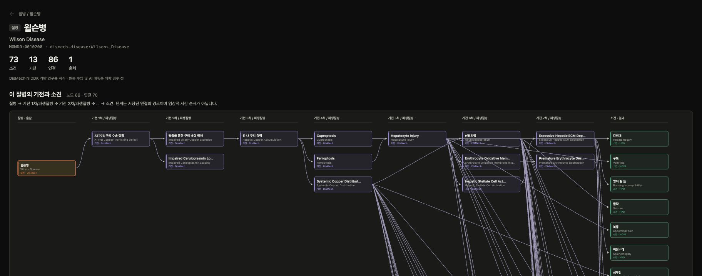
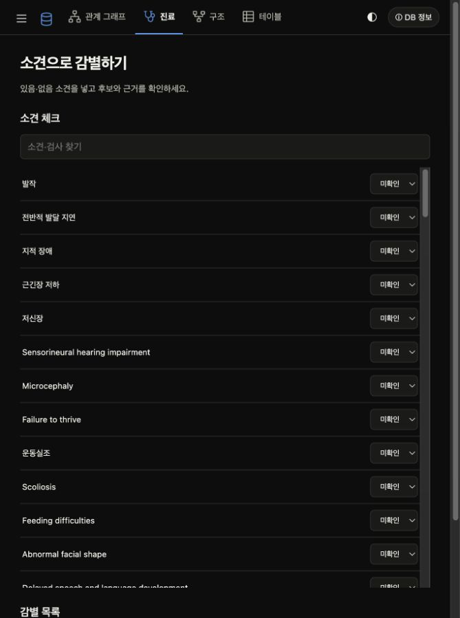
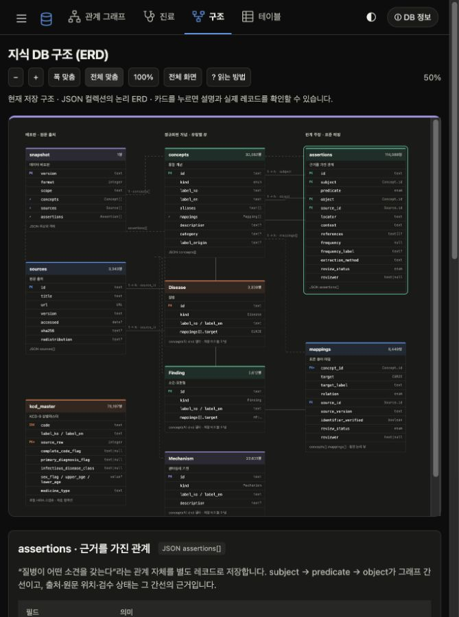
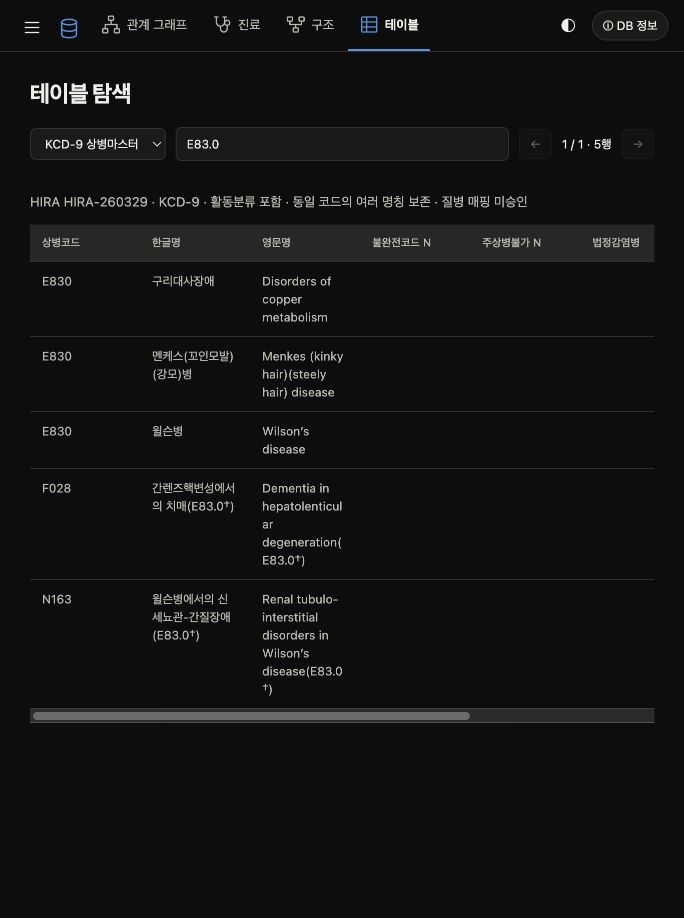

# NOVA 의료 agent 지식 DB

참고 의료 KB의 탐색 구성을 바탕으로 자체 구현한 지식 그래프 탐색기입니다. 촘촘한 개념 목록, 방향별 그래프, 연결 근거 테이블, 진료·구조·테이블 탭을 제공합니다. 밝은/어두운 테마와 모바일 목록 접기를 지원합니다.

## 빠른 시작

Windows에서는 저장소 폴더에서 `./Start-MedDB.ps1`을 실행하면 서버를 숨김 창으로 계속 실행하고 실제 접속 주소를 표시합니다. 이미 실행 중이면 재사용하며 다른 프로그램이 포트를 사용하면 빈 포트를 선택합니다. 로그와 실행 정보는 `.run/`에 있습니다.

Python 3.9 이상을 준비한 뒤 저장소를 내려받아 실행합니다.

```bash
git clone https://github.com/SSAFY16-S11-NOVA2026/MedDB.git
cd MedDB
python3 -m meddb serve
```

브라우저에서 [관계 그래프](http://127.0.0.1:8765/#explore)를 엽니다. 서버 종료는 실행한 터미널에서 `Ctrl+C`입니다. 기본 데이터가 크므로 첫 화면 로딩에 시간이 걸릴 수 있습니다.

포트가 이미 사용 중이면 `python3 -m meddb serve --port 8766`으로 실행하고 `http://127.0.0.1:8766/`을 엽니다.

### 명령줄 조회

```bash
python3 -m meddb serve
# http://127.0.0.1:8765/#explore
python3 -m meddb validate
python3 -m meddb search 윌슨병
python3 -m meddb graph dismech-disease:Wilsons_Disease --include-draft
python3 -m meddb validate --version meddb-2026.10.10.4
```

Python 3.9 이상, 저장소 루트에서 실행합니다. 기본 서버·조회는 외부 패키지가 필요 없습니다. pip 패키지에는 데이터와 웹 자산이 포함되지 않습니다. 로컬 서버만 제공하며 환자 입력을 저장하지 않습니다.

## 화면과 사용법

아래 캡처는 현재 로컬 실행 화면입니다. KCD 화면은 별도 HIRA 자료를 설치한 환경입니다.

### 1. 관계 그래프

[](docs/readme-graph-full.png)

윌슨병의 기전 1–7차와 결과 소견 열이 한 화면에 보이도록 캡처했습니다. 위 미리보기는 상단 경로이며, 이미지를 클릭하면 69개 노드·70개 연결을 모두 담은 전체 캡처를 원본 크기로 볼 수 있습니다.

1. 왼쪽 목록에서 질병·소견·기전 종류를 선택하고 한글명, 영어명, 동의어 또는 HPO·MONDO 코드로 검색합니다. 작은 화면에서는 왼쪽 위 메뉴 버튼으로 목록을 엽니다.
2. 질병을 선택하면 결과 방향 그래프가 `질병 → 기전 1차/파생질병 → 기전 2차/파생질병 → … → 소견`으로 표시됩니다. 파생질병 레코드와 연결 근거가 있는 경우 탐색을 이어갑니다.
3. 노드를 누르면 해당 개념으로 이동합니다. 이전 개념으로 돌아가려면 제목 위 뒤로 버튼을 누릅니다. 선을 누르면 연결 근거 행으로 이동합니다.
4. 긴 그래프는 그래프 안에서 가로·세로 스크롤합니다. `− / ＋`, `폭 맞춤`, `전체 보기`로 크기를 조절합니다.
5. `필터`에서 탐색 깊이(기본 5), 출처, 초안 포함 여부를 선택합니다. 초안을 끄면 현재 대부분의 연결은 숨겨집니다.
6. 그래프 아래 `질병–소견 연관`을 펼치면 직접 연관된 소견을 볼 수 있습니다. 기전 사슬과는 별도로 보존하며, 모든 원본 연결은 `연결 근거` 표에서 확인합니다.

기전 사슬에 이미 다른 경로로 연결된 직통선은 화면에서 숨깁니다. 원본 데이터는 삭제하지 않습니다. 화면의 단계는 표시된 관계 경로이며 임상적 시간 순서를 뜻하지 않습니다. 들어오는 방향 그래프는 선택한 개념으로 이어지는 관계를 보여줍니다.

### 2. 진료 — 소견으로 후보 탐색



1. 상단 `진료` 탭을 엽니다.
2. `소견 찾기`에서 소견명이나 HPO ID를 검색합니다. 예: `발열`, `구토`, `HP:0001945`.
3. 소견마다 `있음 / 없음 / 미확인`을 선택합니다. 검색어를 바꿔도 선택한 소견은 유지됩니다.
4. 후보 조회 버튼을 눌러 일치 소견과 어긋나는 소견, 출처 근거를 확인합니다. 현재 자료를 탐색하려면 초안 포함 설정이 필요합니다.

순위는 소견의 구별력과 지지·반박 근거를 반영한 점수이며 진단 확률이 아닙니다. 미확인은 점수에 반영하지 않고, ‘없음’도 질병의 확정 배제를 뜻하지 않습니다. 동점은 같은 순위로 표시합니다. 질환 범주를 제한할 수 있으며 나이·성별은 검수된 적용 조건이 있을 때만 반영합니다. 현재 배포판에는 나이·성별 적용 조건이 없습니다. 환자 입력은 서버나 파일에 저장하지 않습니다. 계산 방식과 API는 [후보 조회 설명](docs/evidence-ranking.md)을 참고하세요.

### 3. 구조 — 스키마 원리 이해



1. `구조` 탭에서 `폭 맞춤 / 전체 맞춤 / 100%`로 도표 크기를 조절합니다.
2. 카드에 마우스를 올리거나 키보드로 포커스를 옮기면 연결선과 이웃 카드가 강조됩니다.
3. 카드를 누르면 아래 설명으로 이동합니다. 필드 의미와 현재 데이터의 JSON 예시를 확인합니다.
4. `읽는 방법`에서 PK·FK, 중첩 배열, 유형별 뷰의 의미를 확인합니다.

현재 저장소는 JSON입니다. `concepts`, `assertions`, `sources`가 중심이며, `mappings`는 개념 내부 배열입니다. Disease·Finding·Mechanism 카드는 같은 개념 목록을 유형별로 나눈 뷰입니다. 독립 SQL 테이블이 설치된 것은 아닙니다. 자세한 설명은 [스키마 문서](docs/schema.md)를 참고하세요.

### 4. 테이블 — 원문 레코드 검색



1. `테이블` 탭의 선택 메뉴에서 개념·근거 관계·출처·KCD-9 상병마스터를 고릅니다.
2. 검색어를 입력하고 `← / →`로 50행씩 조회합니다.
3. KCD에서는 `윌슨`, `Wilson`, `E83.0`으로 명칭·코드를 검색할 수 있습니다. 같은 코드의 여러 명칭과 원본 Excel 행 번호를 보존합니다.

KCD 자료는 저장소에 포함되지 않습니다. 아래 [KCD-9 로컬 조회](#kcd-9-로컬-조회) 절에 따라 먼저 설치하세요. KCD 명칭 검색 결과와 기존 질병의 이름 일치 후보는 승인된 의학적 매핑이 아닙니다.

상단 테마 버튼으로 밝은/어두운 화면을 전환하고, `DB 정보`에서 데이터 버전·규모·출처를 확인할 수 있습니다.

## 현재 데이터

기본 판: `meddb-2026.10.13.1`. 질병 3,341개, 소견 5,613개, 기전 23,631개, 관계 114,092개, 표준 용어 매핑 8,448개입니다. 기존 `meddb-2026.10.10.4`는 변경하지 않고 보존했습니다. 새 판에는 독립 출처를 근거로 사용장애·체질성 성장지연 관련 개념 3개와 초안 관계 4개를 추가했습니다. [변경 근거](docs/targeted-release.json)를 확인하세요.

- DisMech의 3,333개 YAML 항목을 commit `0cfe4bd579700d42c13d5fcc147e785e52c97966`에 고정해 수입했습니다. 질병→기전, 질병→표현형, 원본에서 명시한 기전 downstream 관계만 변환합니다. 동일 질병으로 명시한 소수의 기존 파일럿 개념을 합쳤고, 질병별 기전 ID는 출처 범위를 유지합니다.
- HPO 공식 `hp/releases/2026-09-01`에서 유효한 표현형 ID를 확인해 동일 ID의 소견을 공유합니다. 이름은 공식 용어로 정규화합니다. HPOA는 수입하지 않았습니다.
- DisMech가 제공한 MONDO 매핑은 출처 그대로 보존하고 별도 확인 완료로 표시하지 않습니다. KCD는 별도 로컬 조회 컬렉션으로 연결했습니다. 기존 질병과의 승인된 KCD 매핑, LOINC 및 검사 지식은 아직 없습니다.
- NIDDK 파일럿 9질병의 원문 근거 관계도 보존합니다. 모든 의학 관계와 의미 매핑은 로컬 의학 검수 전 초안입니다.
- 한국어 이름을 작성한 일부 개념에는 AI 번역 초안임을 기록합니다. 번역되지 않은 용어는 영어 원문을 표시합니다.

탐색 화면은 초안을 기본 표시하되 표시 상태를 알립니다. agent API·RDF export는 초안을 기본 제외합니다. 숫자가 커졌다고 의학적 타당성 검수가 완료된 것은 아닙니다. DisMech는 AI가 정리한 연구용 지식이며 원본의 검수와 우리 검수는 별도입니다. 원문 문헌 인용문은 복제하지 않고 근거 참조 ID 및 원문 파일 위치를 보존합니다. 빈도는 원본 분류 문자열만 보존하고 진단 확률로 변환하지 않습니다.

## 탐색 기능

- 검색 목록: 질병·소견·기전·검사, 한국어/영어/동의어/표준 코드, 연결 수·이름·코드 정렬. 상위 200개를 렌더링하고 전체 검색 가능.
- 방향 그래프: 출발→결과와 들어오는 관계→선택 개념을 분리. 단계·출처·초안 필터, 확대·축소·폭 맞춤·전체 보기. 노드 선택으로 상세 이동, 간선 선택으로 근거 행 강조, 이전 개념으로 복귀.
- 연결 근거: 들어오는/나가는 관계, 원본 위치·맥락·출처·문헌 링크. 그래프는 명시된 관계만 따라가며 표현형 연관을 인과로 바꾸지 않음.
- 진료: 검색 가능한 소견 입력, 있음·없음·미확인, 직접 표현형 공통점 후보와 근거. 미확인은 점수에 반영하지 않으며 부정은 확정 배제가 아님.
- 구조: 개념·주장·출처·표준 매핑의 구조 표시.
- 테이블: 전체 행 검색과 50행 페이지 처리.

## API와 agent

한국어 표현 제안, 데이터 사용 정책, 다음 문진·진찰 제안 및 비교 평가는 [에이전트 연결 문서](docs/agent-integration.md)를 참고하세요. `POST /api/normalize`, `POST /api/suggest`, `kb.normalize(text)`, `kb.suggest(observations, profile="research")`를 지원합니다. 기본 정책은 검수 완료만 포함하며 개발용 초안 정책은 명시적으로 선택합니다.

공식 진료지침 15,904개는 [문서 근거층과 런타임 검색](docs/nova-guidelines-integration.md)으로 연결했습니다. `kb.guidelines("hypnotic insomnia")`와 `POST /api/guidelines`를 사용할 수 있습니다. 대회에서는 `NOVA_GUIDELINES_DIR`의 원문을 읽으며 실행 ZIP에 지침 전체를 넣지 않습니다.

`GET /api/data`는 모든 초안을 포함한 압축 원본 탐색 스냅숏입니다. `GET /api/search?q=HP:0001945`, `GET /api/graph?node=nova:fever&direction=in&depth=2&draft=true&source=DisMech`, `POST /api/rank`.

순위 요청: `{"observations":{"nova:vomiting":"present"},"include_draft":true}`. 방향은 `in`/`out`/`both`. 결과에는 데이터 버전과 순위 산출의 근거가 포함됩니다. 원인 방향 탐색은 질병에서, 결과 방향 탐색은 소견·검사에서 멈춥니다. 파생질병은 깊이 한도 내에서 계속 탐색합니다. 이는 임상 인과추론이나 확률 모델이 아닙니다.

`KB(version="meddb-2026.10.10.4")`와 `KB.TOOLS`, `kb.call(name,args)`를 사용할 수 있습니다. 배포판은 `data/releases/`에 JSON 또는 JSON.gz로 보존하고 SHA256은 압축 전 파일 내용 기준입니다. 원본 탐색 스냅숏의 HTTP 응답은 gzip으로 전송합니다.

## 검증

```bash
python3 -m venv .venv
.venv/bin/python -m pip install -r requirements-ontology.txt
.venv/bin/python -m unittest discover -s tests -v
.venv/bin/python -m meddb validate-rdf --version meddb-2026.10.10.3 --include-draft
.venv/bin/python -m meddb validate-rdf --node dismech-disease:Wilsons_Disease --include-draft
```

26개 Python 테스트: 초안 기본 제외, 미확인·부정 분리, 버전 재현, 방향 탐색, 출처 보존, RDF/SHACL, 잘못된 끝점·근거 누락·검수자 없는 승인 거부. 외부 패키지가 없는 기본 Python에서 SHACL 테스트는 skip됩니다.

전체 최신 JSON은 Python 구조 검증을 통과했습니다. 최신 RDF/SHACL은 윌슨병 결과 방향의 2단계 범위에서 2,424 triple을 검증했습니다(`docs/ontology-validation-expanded.json`). 이전 소규모 판은 전체 RDF 검증했습니다(`docs/ontology-validation.json`). 최신 11만 관계 전체에 대한 SHACL 실행이나 의학적 검수 완료를 의미하지 않습니다.

## 데이터 재수입

```bash
.venv/bin/python -m pip install PyYAML==6.0.3
.venv/bin/python tools/import_dismech.py /path/to/pinned/dismech /path/to/hp.obo --version meddb-YYYY.MM.DD.N
```

Importer는 로컬 고정 checkout만 읽고 YAML safe loader를 사용합니다. 새 판 이름은 --version으로 지정하며 이미 존재하는 판은 importer가 거부합니다. 원본 파일별 SHA256은 `data/terminology/dismech-manifest.json`에 기록했습니다.

이용 조건과 변환 내역: [THIRD_PARTY_NOTICES](docs/THIRD_PARTY_NOTICES.md). 디자인 참고: https://bbi-bbo.github.io/medagent-kb/ . 해당 팀의 코드·폰트·번들 데이터는 복사하지 않았습니다.

## KCD-9 로컬 조회

[HIRA 공식 배포 페이지](https://www.hira.or.kr/rc/drug/insuadtcrtr/bbsView.do?brdBltNo=53117&brdScnBltNo=4&pgmid=HIRAA030069000400)의 `배포용 상병마스터_260329.xlsx`에서 78,197개 명칭 행과 44,846개 고유 코드를 보존합니다. 활동분류도 포함하므로 코드 수는 질병 개념 수가 아닙니다. 원본과 추출본은 재배포 조건 확인 전까지 Git에서 제외했습니다.

```bash
python3 -m venv .venv
.venv/bin/python -m pip install openpyxl
.venv/bin/python tools/import_kcd.py "/path/to/배포용 상병마스터_260329.xlsx" data/terminology/kcd/hira-kcd9-260329.json.gz
python3 -m meddb serve
```

테이블 탭의 `KCD-9 상병마스터`에서 한영 명칭과 점 포함 코드로 검색할 수 있습니다. 구조 탭에 독립 컬렉션으로 표시합니다. 로컬 추출본이 없는 환경에서는 KCD API가 503을 반환하며 기존 그래프는 계속 작동합니다.

- `GET /api/kcd?q=윌슨&offset=0&limit=50`: 원문 명칭 행 검색·페이지 처리.
- `GET /api/kcd/code?code=E83.0`: 코드에 포함된 모든 명칭과 원문 위치.
- `GET /api/kcd/mappings?concept=dismech-disease:Wilsons_Disease`: 이름 일치에 따른 검수 전 매핑 후보. 승인된 매핑이나 질병 동등성 주장이 아닙니다.

KCD 접두어에서 계층을 임의 생성하지 않으며 청구 부가정보를 임상 배제 규칙으로 사용하지 않습니다. KCD 조회는 코드당 여러 명칭 보존·페이지 처리·검수 전 후보 반환을 테스트합니다.


결과 그래프는 출발 질병 → 기전 1차/파생질병 → 기전 2차/파생질병 → … → 소견으로 배치합니다. 순환이 없는 부분은 표시된 간선의 가장 긴 경로로 단계를 결정하고, 순환 부분은 도달 단계로 배치합니다. 이는 임상적 시간 순서나 인과 검수 완료를 뜻하지 않습니다. 탐색 깊이는 도달 범위이고 화면 열은 그 안의 연결 경로 단계라 서로 다를 수 있습니다. 기본 탐색 깊이는 5이며 긴 그래프는 가로 스크롤하거나 폭 맞춤으로 볼 수 있습니다. 기전 단계와 파생질병 탐색을 포함한 Python 테스트는 26개입니다.

기전 사슬 화면은 질병의 직접 has_phenotype 연관을 아래 별도 목록에 보존합니다. 다른 명시 경로로 도달할 수 있는 중복 직통선은 화면에서만 숨기며 원본 주장과 근거 테이블은 유지합니다. 새 인과 관계를 생성하지 않습니다. 표시 로직 검증: `node tests/test_chain_graph.cjs`.
