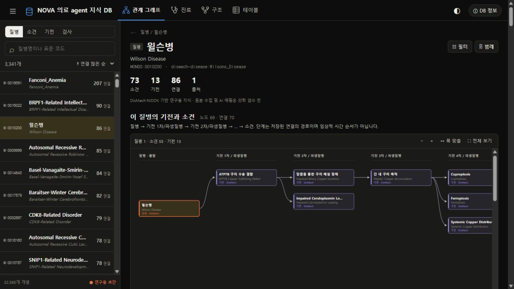
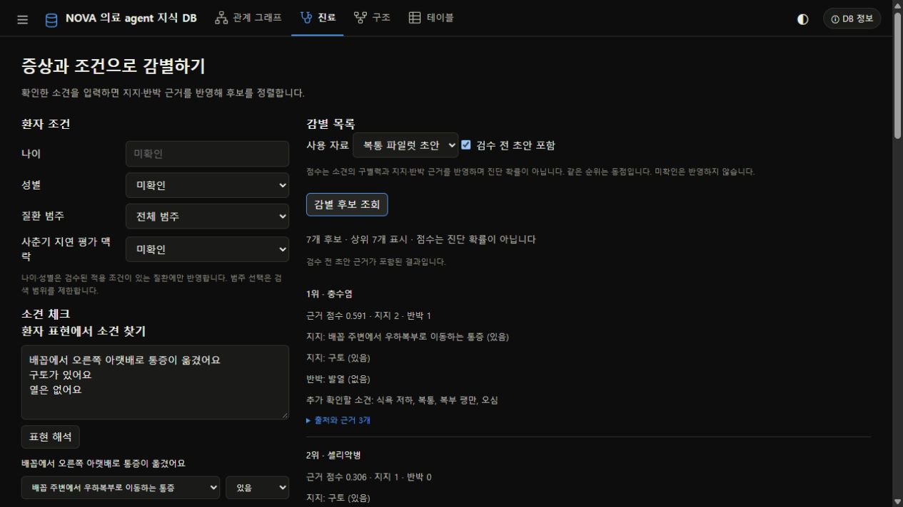
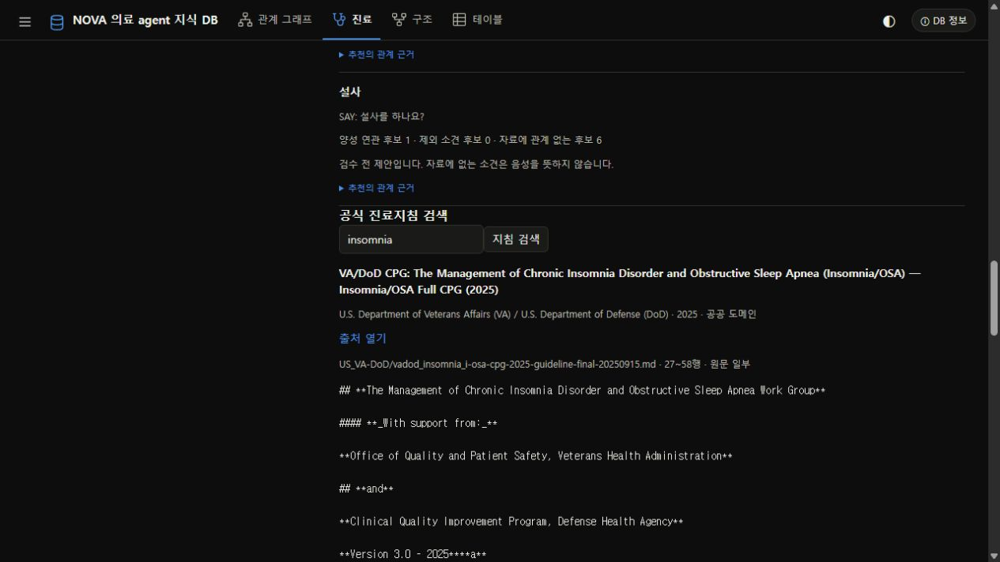
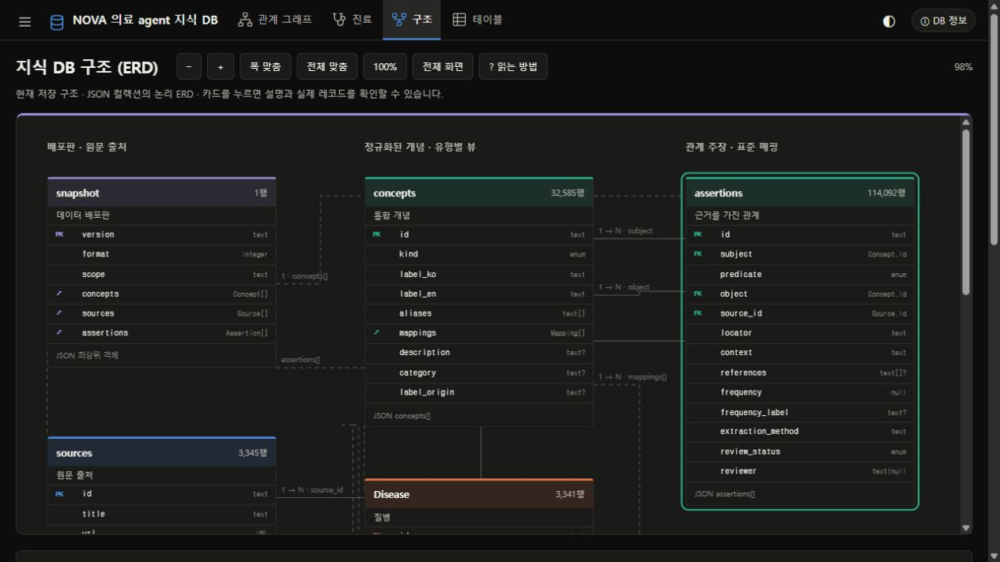
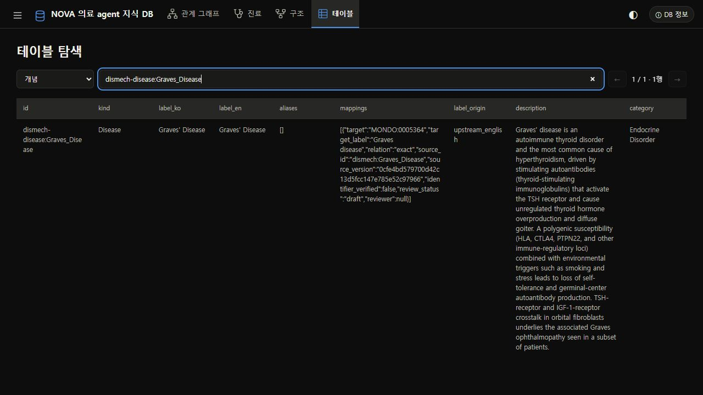

# NOVA 의료 agent 지식 DB

NOVA 대화형 의료 진단 에이전트 개발을 위한 출처 기반 지식 DB입니다. 질환·소견·기전의 관계를 탐색하고, 확인한 환자 정보로 후보와 추가 확인 항목을 조회합니다. Python 조회 도구와 로컬 웹 화면을 제공합니다.

현재 의료 지식은 **검수 전 초안**입니다. 후보 점수는 진단 확률이 아니며, 실제 에이전트의 진단 정확도 개선은 아직 검증하지 않았습니다.

## 빠른 시작

Python 3.9 이상이 필요합니다. 저장소의 데이터·웹 자산을 함께 사용하며 기본 실행에는 추가 패키지가 필요 없습니다.

```bash
git clone https://github.com/77romin/MedDB.git
cd MedDB
python -m meddb serve
```

[사이트 열기](http://127.0.0.1:8765/) · [관계 그래프](http://127.0.0.1:8765/#explore) · [진료](http://127.0.0.1:8765/#diagnosis)

터미널 실행은 `Ctrl+C`로 종료합니다. 기본 포트를 다른 프로그램이 사용하면 `python -m meddb serve --port 8766`으로 실행합니다.

Windows에서 터미널을 닫아도 서버를 유지하려면 다음을 실행합니다.

```powershell
.\Start-MedDB.ps1
```

숨김 창으로 서버를 시작하고 준비 완료를 확인합니다. 실행 중인 MedDB는 재사용하며, 다른 프로그램이 포트를 사용하면 8766~8775에서 빈 포트를 선택합니다. 실제 주소·PID·로그는 `.run/server.json`에 기록합니다. PC 재시작 후에는 다시 실행하세요. `GET /api/health`로 준비 상태와 데이터 버전을 확인할 수 있습니다.

## 현재 화면

2026-10-13에 실제 로컬 사이트에서 다시 캡처했습니다. 진료 예시는 기능 설명용 가상 입력이며 임상 정확도 평가 결과가 아닙니다. 이미지를 누르면 해당 캡처의 원본 또는 전체 화면을 볼 수 있습니다.

### 1. 관계 그래프

[](docs/readme-graph-full.jpg)

윌슨병의 방향 그래프입니다. 화면 캡처에는 일부 경로가 보이며, 링크의 전체 그래프에는 69개 노드와 70개 연결이 있습니다.

- 한국어명·영어명·별칭·HPO/MONDO 코드로 개념을 찾습니다. 한국어명이 없는 항목은 영어명이나 ID로 검색하세요.
- 노드를 누르면 해당 개념으로 이동하고, 연결선을 누르면 근거 행을 확인합니다. `이전 개념`으로 돌아갈 수 있습니다.
- `필터`에서 깊이(기본 5), 출처, 초안 포함 여부를 설정합니다. 긴 그래프는 스크롤·확대/축소·폭 맞춤으로 탐색합니다.
- 질병의 직접 `has_phenotype` 연관은 아래 별도 목록에 보존합니다. 다른 경로가 있는 중복 직통선은 화면에서만 숨기며 원본 주장은 유지합니다.

**기전 단계는 저장된 관계 경로의 배치입니다.** 임상적 시간 순서나 진단 확정 단계가 아닙니다. 중간 기전에서 소견으로 직접 이어지는 선도 있을 수 있습니다. 마지막 열의 `관찰 가능한 소견`은 증상·소견을 뜻하며 최종 진단을 뜻하지 않습니다. 반대 방향으로 연결을 따라갔다고 질환이 확정되는 것도 아닙니다.

### 2. 진료: 증상·조건과 근거 확인

[](docs/readme-diagnosis-full.jpg)

1. 환자 표현을 증상별로 한 줄씩 입력하고 `표현 해석`을 누릅니다.
2. 제안된 개념과 `있음 / 없음 / 미확인` 상태를 확인한 뒤 적용합니다. 직접 소견명·HPO ID로 검색해 선택할 수도 있습니다.
3. 나이·성별·질환 범주·사춘기 지연 평가 맥락을 입력하고 사용할 자료 범위를 선택합니다.
4. 후보 조회로 점수, 지지·반박 근거, 동점 순위, 추가 확인 소견과 질문·진찰 제안을 확인합니다.

한국어 표현 사전은 24항목이며 전체 한국어를 이해하는 모델이 아닙니다. 과거·가족력·부정 범위가 모호하거나 표현이 상충하면 미확인으로 남깁니다. 기간 표현은 보존하지만 점수 규칙으로 자동 변환하지 않습니다.

| 설정 | 처리 |
|---|---|
| 있음·없음 | 소견의 데이터 내 구별력과 지지·반박 근거를 반영 |
| 미확인 | 점수에 반영하지 않음 |
| EXCLUDED | 원본의 부정 의미로 처리; 상충 관계는 점수에서 제외 |
| 나이·성별 | 검수된 질환 적용 조건이 있는 경우에만 필터링; 현재 해당 규칙 없음 |
| 사춘기 지연 평가 맥락 | 평가 대상이 아니라고 확인한 경우 관련 소견을 점수·추천에서 제외 |
| 질환 범주 | 사용자가 선택한 자료 범위를 제한 |

사춘기 평가의 적절성은 나이 숫자만으로 자동 판정하지 않습니다. 미확인일 때 직접 사춘기 지연 질문의 실행 템플릿은 보류합니다. 이 설정은 질환 자체를 제외하는 규칙이 아닙니다.

점수는 **진단 확률·정확도·신뢰도 퍼센트가 아닙니다.** 부정 소견도 확정 배제를 뜻하지 않습니다. 소견이 자료에 기록되지 않았다는 것은 환자에게 그 소견이 없다는 의미가 아닙니다. 웹 입력은 서버나 파일에 저장하지 않습니다. [계산 방식](docs/evidence-ranking.md) · [맥락·진료 지식](docs/clinical-pathways.md)

### 3. 공식 진료지침 검색

[](docs/readme-guidelines.jpg)

진료 화면 아래에서 한국어 또는 영어로 지침을 찾습니다. 결과에는 기관·연도·라이선스·출처 URL·원본 경로·행 위치와 원문 일부가 붙습니다. 제목·기관·문서 유형의 어휘 검색이며, 검색 결과가 개별 환자에게 적용되는 의학적 근거라는 판정은 아닙니다.

공식 문서 15,904개의 원문과 이용 조건은 로컬에서 보존합니다. 질환 791개에 대한 문서 제목 참고 연결 2,686개는 의료 주장과 분리해 관리합니다. 본문 전체를 자동으로 검수된 임상 관계로 변환한 것은 아닙니다.

로컬에서는 [NOVA 개발 가이드](https://nova.snubhai.org/docs/#guidelines)의 지침 ZIP을 내려받아 풀고 경로를 설정합니다.

```powershell
$env:NOVA_GUIDELINES_DIR = 'C:\path\to\guidelines'
python -m meddb serve
```

현재 작업 폴더의 기본 로컬 경로는 `data/external/guidelines/guidelines`입니다. 공식 대회 컨테이너에서는 `NOVA_GUIDELINES_DIR`가 `/opt/nova/guidelines`를 가리킵니다. 실행 중 인터넷 다운로드를 하지 않고 이 경로를 읽으므로 지침 전체를 제출 ZIP에 넣을 필요가 없습니다.

원문·증례·SDK 다운로드는 Git에서 제외되어 새 clone에 포함되지 않습니다. 문서별 출처와 라이선스를 유지하며, 변경본 재배포를 제한하는 자료는 원문을 보존해 사용합니다. [자료 구성과 처리 내역](docs/nova-guidelines-integration.md)

### 4. 구조: 저장 스키마

[](docs/readme-schema.jpg)

`구조` 탭에서 확대·폭 맞춤·전체 맞춤을 사용하고, 카드를 눌러 필드 설명과 실제 레코드를 확인합니다. 마우스 또는 키보드 포커스로 연결된 카드를 강조할 수 있습니다.

현재 의료 데이터는 버전별 압축 JSON입니다. `concepts`, `assertions`, `sources`가 중심이며 외부 `mappings`는 개념 내부 배열입니다. 질병·소견·기전 카드는 같은 개념 목록을 나눈 뷰입니다. 독립 SQL 의료 테이블이 설치된 것은 아닙니다. 지침 검색의 작은 메모리 SQLite 인덱스는 이 의료 저장 구조와 별개입니다. [스키마 설명](docs/schema.md)

### 5. 테이블: 원문 레코드 검색

[](docs/readme-table.jpg)

`테이블` 탭에서 개념·근거 관계·출처를 선택하고 이름·ID·원문 필드로 검색합니다. 한 페이지에 50행씩 표시합니다. 캡처는 `dismech-disease:Graves_Disease` 개념의 원문 조회입니다.

KCD-9는 별도로 설치하는 로컬 컬렉션입니다. 현재 캡처 환경에는 없으며, 설치하지 않은 경우 KCD 조회는 503을 반환합니다. 기존 의료 그래프와 조회는 계속 작동합니다.

## 데이터와 검수 상태

기본 판은 `meddb-2026.10.13.1`입니다. 과거 판은 `data/releases/`에서 그대로 보존하며 중복된 비압축 스냅숏은 제거했습니다.

| 항목 | 개수 |
|---|---:|
| 질병 | 3,341 |
| 소견 | 5,613 |
| 기전 | 23,631 |
| 개념 전체 | 32,585 |
| 의료 관계 | 114,092 |
| HPO·MONDO 매핑 | 8,448 |
| 의료 출처 | 3,345 |
| 검수 완료 의료 관계 | 0 |

- DisMech 3,333개 YAML 항목을 commit `0cfe4bd579700d42c13d5fcc147e785e52c97966`에 고정해 수입했습니다. 명시된 질병–기전·표현형·downstream 관계를 가져오며 임의의 인과 사슬을 생성하지 않습니다.
- HPO `hp/releases/2026-09-01`의 유효 ID·이름을 확인하고 같은 ID의 소견을 공유합니다. HPOA는 수입하지 않았습니다.
- DisMech의 MONDO 매핑은 별도 의미 검수 완료로 표시하지 않습니다. 한국어 이름·표현 매핑의 일부도 AI 번역 초안입니다.
- NIDDK 복통 파일럿 9질병의 원문 근거를 유지합니다. 최신 판에는 독립 출처를 근거로 개념 3개·초안 관계 4개를 추가했습니다. [변경 근거](docs/targeted-release.json)
- 승인된 KCD 매핑과 LOINC 검사 지식은 아직 없습니다. `Test` 등의 타입이 있다고 실제 검사 자료가 채워진 것은 아닙니다.

출처·원문 위치·맥락·문헌 참조·검수 상태를 관계마다 추적합니다. 숫자 빈도·질환 사전확률은 구현하지 않았고 원본 빈도 문자열을 진단 확률로 바꾸지 않습니다. 원본 수입과 독립 임상 검수는 별개의 작업입니다.

## 에이전트 연결

### 자료 사용 정책

| profile | 범위 | 현재 관계 |
|---|---|---:|
| reviewed | 검수 완료만, API 기본값 | 0 |
| pilot | NIDDK 복통 파일럿 초안 | 50 |
| research | 전체 연구용 초안 | 114,092 |

웹은 초안을 명시적으로 포함하는 개발 화면입니다. API와 RDF export는 의료 관계의 초안을 기본 제외합니다. 기본 후보가 비어 있다고 질병이 없다는 뜻은 아닙니다.

### 출처가 있는 조회 규약

```python
from examples.knowledge_session import KnowledgeSession

session = KnowledgeSession(profile='research')
event = session.record_result('say', 1, '잠을 잘 못 자요')
# 에이전트/검수자가 실제 응답과 의미 매핑을 확인한 후 적용
session.confirm_observation('hpo:HP:0100785', 'present', [event])
support = session.support()
```

`prepare()`에서 KB를 로드하고 증례마다 세션을 새로 만듭니다. `initial/say/exam/test` 이벤트에는 제공된 시작 정보 또는 성공한 SDK 응답만 기록합니다. 알고 있는 소견·환자 조건·문진 완료 상태는 이벤트 출처가 필요합니다. 질문만 보냈거나 요청이 실패한 기록을 환자 사실로 사용하지 않습니다. 예선에서는 검사 결과를 입력할 수 없습니다.

응답은 후보·근거·추가 확인 소견과 함께, 출처 기반 문진·감별·계획 요구사항을 제공합니다. 불면·수면제 사용, 아동 성장, 갑상선 과다 기능의 3개 보조 경로에 요구사항 12개가 있습니다. 모두 초안 제안이며 자동 진단·치료 규칙이 아닙니다.

계약 검증은 참조와 형식을 검사하며 문장의 의학적 의미가 참인지 판정하지 않습니다. 원문과 의미 매핑의 대조, 모델 호출·재시도·남은 턴·마감·SOAP 작성·DIAGNOSE는 에이전트가 관리합니다. 일반 의료 지식을 환자에게 관찰된 사실처럼 기록하지 않습니다.

[조회 규약과 JSON 스키마](docs/agent-contract.md) · [연결 예제](examples/agent_knowledge.py) · [단계별 개발 기록](docs/staged-development-2026-10-13.md)

### API

| 경로 | 기능 |
|---|---|
| `GET /api/health` | 서비스 준비·데이터 버전 |
| `GET /api/data` | 초안 포함 탐색 스냅숏, gzip 전송 |
| `GET /api/search?q=HP:0001945` | 개념 검색 |
| `GET /api/graph?node=nova:fever&direction=in&depth=2&draft=true` | 명시된 방향 관계 탐색 |
| `POST /api/normalize` | 한국어 표현의 확인 전 매핑 제안 |
| `POST /api/rank` | 소견·조건의 근거 점수 |
| `POST /api/suggest` | 후보와 다음 확인 항목 |
| `POST /api/assist` | 이벤트 출처를 요구하는 팀 연결 규약 |
| `POST /api/guidelines` | 라이선스·출처가 붙은 원문 지침 검색 |

`KB(version='meddb-2026.10.13.1')`, `KB.TOOLS`, `kb.call(name, args)`로 직접 호출할 수도 있습니다. 그래프 방향은 in/out/both, 깊이는 0~5입니다. 결과 방향은 소견·검사에서 멈추고 파생질병은 깊이 범위 안에서 계속 탐색합니다. 관계 탐색은 임상 인과추론 엔진이 아닙니다.

### 오프라인 전달 번들

```bash
python tools/package_agent_knowledge.py
```

`dist/nova-knowledge-bundle.zip`에 Python 코드, 의료 데이터 한 판, 정책·사전·보조 경로, 조회 규약과 연결 예제를 담습니다. 압축을 풀어 별도 Python 프로세스에서 로딩·조회·해시를 확인합니다. 공개 증례 정답·대본·평가용 점검표·지침 원문은 포함하지 않습니다.

**완성된 대회 제출물은 아닙니다.** 에이전트 팀이 공식 SDK, run.py, requirements.txt와 연결해야 합니다. 실행 중 다운로드를 하지 않는 로컬 경로를 사용합니다. `pip` 패키지만 설치하면 의료 데이터·웹 자산은 포함되지 않습니다.

## 검증과 비교

### 팀 임상 KB와 통합 실행

팀 PR #1의 주호소 중심 `MedDB`를 출처·기전 중심 `KB`와 함께 제공합니다. 임상 KB는 주호소 19개, 질환 134개, 소견 289개, 진찰 56개를 포함하며 모두 임상 검수 전입니다. [통합 설계와 변경 내역](docs/clinical-integration.md) · [임상 출처 기록](docs/SOURCES.md)

```powershell
python -m meddb clinical validate
python -m meddb clinical stats
python -m meddb clinical demo "기침이 있어요"
python -m meddb clinical page docs/viewer.html
python tools/compare_integrated_knowledge.py
```

기존 `python -m meddb serve`와 웹 화면은 유지합니다. [임상 흐름 탐색 화면](docs/viewer.html)은 별도 HTML입니다. [임상 스키마](docs/clinical-schema.md)와 [온톨로지 스키마](docs/ontology-schema.md)를 구분했습니다.

하이브리드 에이전트는 `clinical`(기존 기본), `ontology`, `integrated` 모드를 제공합니다. 명시적인 소견 매핑 5개는 모두 초안이며 `research` 프로필에서만 사용합니다. 기본 `reviewed`에서는 초안 매핑을 적용하지 않습니다. 두 KB의 점수는 각각 제공하며 합산하지 않습니다.

공식 starter와 SDK가 로컬에 있다면 실행 코드를 포함한 통합 ZIP을 생성할 수 있습니다.

```powershell
python tools/make_submission.py --starter data/external/starter/run.py --agent hybrid --knowledge-mode integrated --reference-profile research
```

`dist/submission_hybrid.zip`은 압축 해제한 별도 환경에서 `run.prepare()`와 두 KB·매핑 로딩을 확인합니다. 공개 샘플·정답·평가 자료·PPT·진료지침 본문은 포함하지 않습니다. ZIP 생성과 로딩 검증은 실제 대회 실행 성공이나 임상 검수 완료를 뜻하지 않습니다. starter/SDK는 새 clone에 포함되지 않으며, 외부 임상 데이터의 이용 조건은 [팀 출처 장부](docs/SOURCES.md)에 기록되어 있습니다.

[통합 오프라인 재생 결과](docs/integrated-knowledge-replay.json)는 경계 사례 3개 × 지식 입력 3종의 9회 조회입니다. 모델 호출 0회로, 실제 진단 정확도·SOAP 점수·턴 수·모델 비용은 측정하지 않았습니다.

### 자동 검증

```bash
python -m unittest discover -s tests -v
node --check web/app.js
node --check web/agent-ui.js
node tests/test_chain_graph.cjs
python tools/build_public_checklists.py
python tools/compare_knowledge_offline.py
```

최근 Python 실행 결과는 **총 121개 중 117개 통과, RDF/SHACL 관련 4개 skip**입니다. 구조·출처·초안 정책·부정/미확인·환자 맥락·조회 계약·HTTP handler·버전 재현 및 임상 KB 통합을 확인합니다. 웹의 그래프·표현 해석·후보 조회·지침 검색을 실제 브라우저에서도 확인했습니다.

공개 증례 3건의 19항목 점검표와 9회의 고정 버전 KB 비교를 만들었습니다. 비교는 시작 정보와 일부 진찰표 소견을 평가자가 직접 제공한 **오프라인 참고 사실 재생**입니다. 모델 호출은 0회이며 실제 진단 정확도·진료 턴·모델 비용·SOAP 점수를 측정하지 않았습니다. 추가 정보가 생겼지만 응답 크기도 증가했으므로 성능·효율 개선으로 단정하지 않습니다.

[점검표](docs/public-case-checklists.md) · [비교 결과](docs/offline-knowledge-comparison.md) · [실제 비교 실행 도구](docs/agent-ablation.md)

RDF 검증은 별도 의존성이 필요합니다.

```bash
python -m pip install -r requirements-ontology.txt
python -m meddb validate-rdf --node dismech-disease:Wilsons_Disease --include-draft
```

이전 판의 전체 검증과 윌슨병 일부 범위의 RDF/SHACL 기록은 `docs/ontology-validation*.json`에 보존합니다. 최신 관계 전체의 SHACL 또는 임상 검수 완료를 의미하지 않습니다. 데이터 SHA256은 압축 해제한 파일 바이트를 기준으로 하며 코드·정책 버전도 실험 기록에 함께 남깁니다.

## KCD-9 별도 설치

[HIRA 공식 자료](https://www.hira.or.kr/rc/drug/insuadtcrtr/bbsView.do?brdBltNo=53117&brdScnBltNo=4&pgmid=HIRAA030069000400)의 상병마스터는 재배포 조건 확인 전까지 원본·추출본을 Git에서 제외합니다. 기존 기록은 78,197개 명칭 행과 44,846개 고유 코드를 보존하며 활동분류도 포함하므로 고유 코드 수가 질병 수는 아닙니다.

```bash
python -m pip install openpyxl
python tools/import_kcd.py "/path/to/배포용 상병마스터_260329.xlsx" data/terminology/kcd/hira-kcd9-260329.json.gz
python -m meddb serve
```

- `GET /api/kcd?q=윌슨&offset=0&limit=50`: 명칭 행 검색.
- `GET /api/kcd/code?code=E83.0`: 같은 코드의 여러 명칭과 원문 위치.
- `GET /api/kcd/mappings?concept=dismech-disease:Wilsons_Disease`: 이름 일치 기반 검수 전 후보.

명칭 일치를 승인된 질병 동등성으로 보지 않습니다. 코드 접두어로 계층을 임의 생성하거나 청구 부가정보를 임상 배제 규칙으로 사용하지 않습니다.

## 데이터 재수입과 출처

```bash
python -m pip install PyYAML==6.0.3
python tools/import_dismech.py /path/to/pinned/dismech /path/to/hp.obo --version meddb-YYYY.MM.DD.N
```

로컬 고정 checkout과 YAML safe loader를 사용하며 기존 릴리스 덮어쓰기를 거부합니다. 새 수입은 설명·참조를 길이 제한으로 자르지 않고 원본 조건을 보존합니다. 이미 수입된 과거 판의 잘린 정보를 소급 복원한 것은 아닙니다. 원본 파일 해시는 `data/terminology/dismech-manifest.json`에 있습니다.

[이용 조건·변환 내역](docs/THIRD_PARTY_NOTICES.md) · [분석과 남은 작업](docs/ontology-review-2026-10-13.md) · [사이트 실행 문제](docs/site-restoration.md)

화면 구성은 [참고 KB 탐색기](https://bbi-bbo.github.io/medagent-kb/)를 참고해 자체 구현했습니다. 해당 팀의 코드·폰트·번들 데이터는 복사하지 않았습니다. 발표 자료의 원본과 추출 파일은 `docs/nova_competition/`에 보존합니다.
