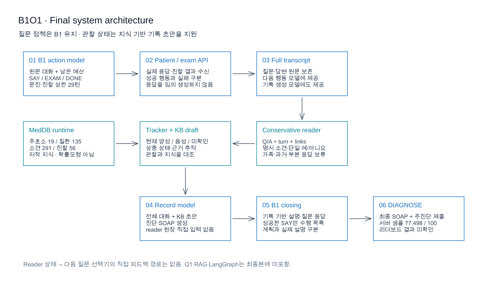
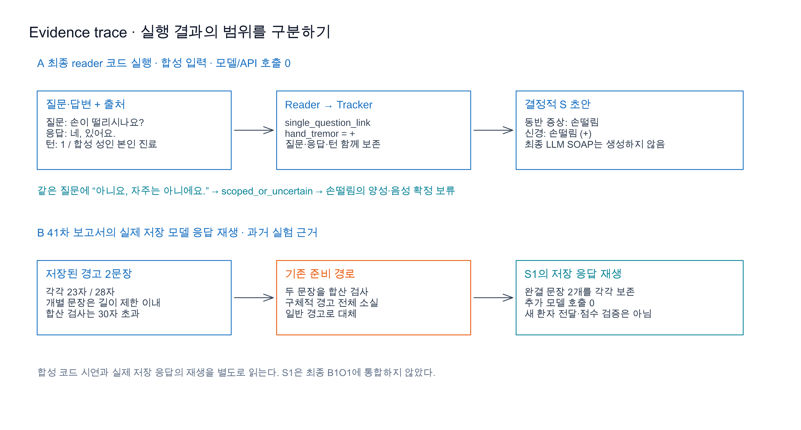
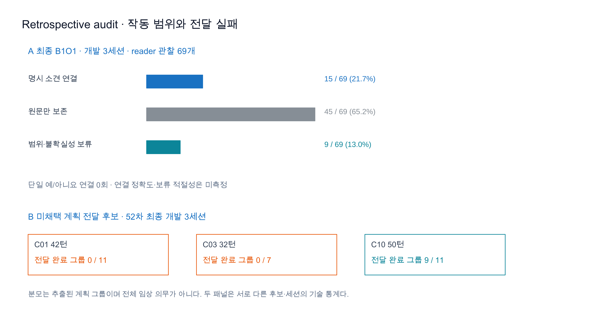
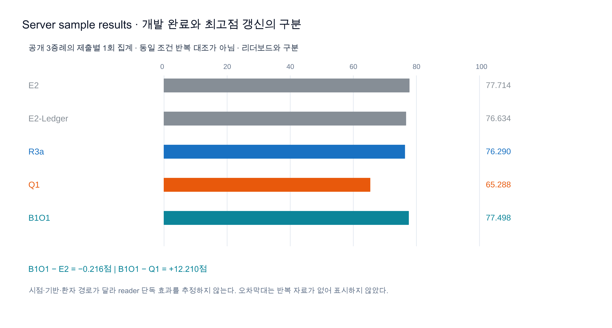

# 관찰 근거 기반 의료 AI 에이전트의 설계와 실패에 대한 고찰

*A Retrospective Study of an Observation-Grounded Medical AI Agent*

N.O.V.A. 2026 기술 사례연구 · 개발 종료 2026-10-23 · 고찰 편찬 2026-11-08 · 최종 후보 **B1O1**

> 고정 LLM과 의료 지식, 관찰 해석, 행동 예산, 기록·설명 흐름을 결합한 에이전트 시스템 연구다. 모델 가중치를 학습한 연구는 아니다. 개발은 종료했으며, 이번 편찬은 공개된 과거 결과의 재분석과 오프라인 코드 시연으로 한정한다. 동료 심사 논문이나 실제 환자 대상 임상 검증 결과가 아니다.

## 초록

본 프로젝트는 제한된 상호작용 예산 안에서 가상 환자의 응답과 진찰 결과를 수집하고, 의료 온톨로지를 참고하여 주진단과 SOAP 기록을 제출하는 Doctor Agent를 개발하였다. 기존 팀의 MedDB·E2·B1을 기반 자산으로 활용하고, 독립 하네스, 관찰 원장, 감별 수렴 관찰, 지침 검색, 역할 분리 생성, 안전 계획 전달, 모델 주도 질문 선택을 실험하였다. 최종 B1O1은 B1의 문진·종료 구조를 유지하면서 질문–응답 출처를 보존하는 보수적 reader를 적용하였다.

최종 서버 샘플 집계는 **77.498/100**으로 Q1의 65.288에서 회복했으나 초기 E2의 77.714를 넘지 못했다. 최종본의 리더보드 성능과 reader 단독 기여는 확인하지 못했다. 개발 3세션의 reader 관찰 69개 중 명시적 소견을 연결한 행은 15개였고, 짧은 예·아니요를 질문에 연결하는 신규 분기는 실행되지 않았다. 과거 별도 후보에서는 계획을 실제로 설명하지 않고 수행 완료로 기록하거나, 형식 검증이 설명을 차단하는 실패도 관찰하였다.

본 고찰은 원문 보존, 의미 해석, 질문 선택, 실제 설명, 최종 기록의 일치를 서로 다른 평가 대상으로 다룬다. 공개 집계의 정합성과 합성 입력의 처리 경로는 다시 확인했으나, 원문 세션 로그가 없는 현재 체크아웃에서 문장별 SOAP 충실도와 임상 완전성을 새로 판정하지 않았다. 연구의 결과는 각 경계를 구분하는 설계와 검증의 필요성, 그리고 성능 개선을 입증하지 못한 범위를 함께 제시하는 데 있다.

**핵심어:** 의료 에이전트, 관찰 출처, 온톨로지, SOAP, 안전 전달, 실패 분석, 재현성

## 1. 연구 질문별 결론

### 1.1 문제와 연구 범위

출발점은 기존 에이전트의 점수 정체였다. 지식과 상태 관리를 추가하면 필요한 정보를 더 잘 수집하고 일관된 기록을 만들 수 있다는 가설 아래 개발 API 실행, 로그 분석, 수정, 비교를 반복하였다. 당시 목표는 리더보드 78 → 85 → 90점이었다. 이 목표를 달성했다는 결과는 확보하지 못했다.

런타임 Doctor는 `openai/gpt-6-luna`였으며 개발 검토 모델과 구분한다. 과거 발표 자료의 다른 모델명과 당시 구현 계약을 혼합하지 않는다. 행동 길이와 최대 50턴 안에서 실제 응답·진찰 결과에 근거하여 진료해야 했고, 기록에 계획을 적는 것과 행동을 실제 수행하는 것은 평가상 구별되었다. 보존된 [실행 자료 슬라이드 10](docs/nova_competition/deck_01/slides.md#슬라이드-10)은 개발 샘플, 제출 ZIP 샘플 검증, 공식 평가의 채점 조건이 다름을 명시한다. 샘플 점수와 리더보드는 별도로 해석한다.

### 1.2 질문–근거–결론의 대응

| 연구 질문 | 관찰된 근거 | 이 연구에서의 결론 | 남은 판단 |
|---|---|---|---|
| **RQ1. 원문과 구조화 관찰의 병행 보존이 정보 소실·잘못된 정상화를 줄이는가?** | E2-Ledger 개발 3세션에서 122개 근거의 포착·처리 추적. B1O1에서 Q/A·턴·연결 보존. 합성 입력에서 부분 부정·가족·상충 처리 확인 | 보존과 상태 추적의 구현은 확인했다. 의미 해석 정확도와 최종 SOAP의 사실 누락 감소는 별도 검증이 필요하다 | 원장 포착을 임상 사실 재현율로 간주할 수 없다. 최종 기록의 문장별 감사는 미측정 |
| **RQ2. 온톨로지와 검색 근거가 문진·감별·기록을 개선하는가?** | MedDB 기반 초안과 R1–R4 검색 실험. R3a 샘플 76.290, R4 67.312. 최종 B1O1에는 RAG 미포함 | 지식의 적용 위치와 환자 적합성 선별이 중요했다. 지식·검색의 추가 자체가 일관된 향상을 보이지 않았다 | 최종 B1O1에서 지식 미사용 대조와 reader 단독 점수 효과는 미확인 |
| **RQ3. 안전 계획과 실제 설명·기록 사이의 간극을 줄일 수 있는가?** | 41차에서 미발화 교육 완료 기록과 길이 검사에 의한 경고 소실 관찰. 52차 전달 후보에서 그룹 완료 0/11·0/7·9/11 | 계획·성공 발화·수행 기록을 분리해야 한다. 강한 형식 검증도 실제 전달을 막을 수 있었다 | 의미·임상 적절성을 포함한 전체 전달 완전성은 확보하지 못했다 |
| **RQ4. 추가 추론 비용이 이득을 상쇄하는가?** | Q1의 호출·입력 증가와 샘플 회귀. B1 기반 전환 후 비용 범위 회복 | 추가 호출은 기능의 효과와 함께 평가할 설계 비용이다. Q1은 채택 근거를 확보하지 못했다 | 기반·경로·시점이 달라 비용 증가가 감점을 일으킨 인과량은 추정하지 않는다 |

근거는 [22차 원장 분석](nova_harness/reports/analysis_022.md), [41차 안전 전달](nova_harness/reports/development_041.md), [52차 미채택 전달 후보](nova_harness/reports/development_052.md), [54차 Q1](nova_harness/reports/development_054.md), [57차 B1 대조](nova_harness/reports/development_057.md)에 연결된다. 각 행은 서로 다른 후보의 관찰을 포함하며 모두 최종본의 기능이라는 뜻은 아니다.

## 2. 실제 처리 사례와 최종 시스템

### 2.1 최종 아키텍처의 역할 경계



**그림 1.** 현재 소스의 호출 경로를 Excalidraw로 작성했다. 다음 행동 모델은 원문 대화와 남은 예산으로 행동을 선택한다. Reader 상태는 Tracker와 지식 기반 기록 초안에 사용되며, 다음 질문 선택기에 직접 입력되지 않는다. 기록 모델에는 전체 대화와 KB 초안이 제공되지만 `b1_observations` 원장 전체가 별도 입력으로 들어가지는 않는다. [편집 원본](nova_harness/assets/retrospective/fig01_final_architecture.excalidraw) · [SVG](nova_harness/assets/retrospective/fig01_final_architecture.svg).

최종본은 [B1의 실행 흐름](examples/agent_b1.py)에 [별도 진입점](examples/agent_b1_observed.py)과 [보수적 reader](examples/reader_b1_observed.py)를 연결한다. B1의 문진·진찰 상한 29턴, DONE, 마무리와 기록 흐름을 유지한다. 29턴은 전체 진료 턴이 아니며 실제 최종 서버 샘플의 40–41턴과 구별된다. 추가 관찰 추출 모델, Q1 선택기, RAG, LangGraph는 최종본에 결합하지 않았다.

MedDB는 개념·관계·출처·매핑과 검수 상태를 관리하는 참조 자산과, 에이전트가 사용하는 임상 저작 부분집합으로 구성된다. 당시 참조 릴리스는 개념 32,585개·assertion 114,092개·출처 3,345개, 임상 런타임은 주호소 19개·질환 135개·소견 291개·진찰 56개·슬롯 19개였다. 최종본이 전체 참조 그래프를 OWL 추론기로 실행하는 것은 아니다. 질환–소견 연관은 저작 지식이며 진단확률로 해석하지 않는다. [통계](nova_harness/docs/paper/ontology_statistics.json), [출처·검수 상태](docs/SOURCES.md), [기존 지식 DB와 탐색 화면](docs/README_knowledge_archive.md)을 함께 참고한다.

### 2.2 최종 코드에 합성 입력을 넣은 처리 사례

원문 진료 로그가 포함되지 않은 현재 체크아웃에서는 최종 세션의 특정 발화를 새로 인용할 수 없다. 아래는 기존 회귀 사례를 바탕으로 **현재 reader와 결정적 S 초안을 실제 실행한 합성 시연**이다. 가상환자 API나 LLM을 호출하지 않았으며 실제 환자의 대화 또는 최종 LLM SOAP로 제시하지 않는다.

합성 조건은 40세 여성 본인의 체중 감소 진료, 질문은 DB의 표준 문장 `손이 떨리시나요?`, 응답 턴은 1이다. 각 행은 독립된 Tracker로 실행했다.

| 입력 응답 | Reader 결과 | Tracker와 S 초안에서 확인한 결과 | 해석 |
|---|---|---|---|
| `네, 있어요.` | `single_question_link`, `hand_tremor: +` | 현재 양성에 손떨림 등록. S.hpi에 `동반 증상: 손떨림`, S.ros에 `신경: 손떨림 (+)` | 질문의 단일 소견에 짧은 응답을 연결하는 코드 경로 확인 |
| `아니요, 자주는 아니에요.` | `scoped_or_uncertain` | 손떨림을 양성·음성으로 등록하지 않음 | 빈도 제한을 절대 부재로 확정하지 않음 |
| `아버지가 손을 떠세요.` | `scoped_or_uncertain` | 환자 본인의 손떨림으로 등록하지 않음 | 대상 범위 확대를 보류. 가족력 전체를 구조화했다는 뜻은 아님 |
| `설사는 없어요.` | `explicit`, `diarrhea: -` | 설사 음성 등록, 질문한 손떨림은 미확인 | 응답에 없는 질문 target을 임의로 음성 처리하지 않음 |
| `아니요, 없어요.` + 선행 손떨림 양성 | 음성 연결 이벤트와 기존 양성 충돌 | 손떨림이 `unknown`·`conflicts`에 남음 | 연결 이벤트의 판정과 현재 유효 상태는 구분됨 |

[실행 결과 JSON](nova_harness/docs/paper/retrospective_audit.json)의 `synthetic_processing_examples`에는 원문, 연결, Tracker와 S 초안이 함께 있다. 이 다섯 사례는 기능 시연이며 임상 골드셋의 정확도 측정이 아니다. 최종 기록 모델이 원문과 초안을 어떻게 조정하는지는 이번 시연에 포함하지 않았다.

### 2.3 실제 저장 응답에서 확인된 계획→발화 준비 손실



**그림 2.** 위는 이번에 실행한 합성 코드 시연, 아래는 41차 보고서와 공개 JSON에 보존된 과거 저장 응답 재생 결과다. 두 종류의 근거를 합쳐 새 전체 진료 실험으로 세지 않는다. [편집 원본](nova_harness/assets/retrospective/fig02_processing_cases.excalidraw) · [SVG](nova_harness/assets/retrospective/fig02_processing_cases.svg).

[41차 보고서](nova_harness/reports/development_041.md)는 실제 C10 모델 출력의 경고가 각각 23자와 28자의 완결 문장 두 개였다고 기록한다. 각 문장은 행동 길이 이내였으나 기존 준비 경로는 합산 길이로 검사하여 두 문장을 일반 경고로 대체하였다. 같은 저장 응답을 재사용한 수정 경로는 추가 모델 호출 없이 두 문장을 보존했다. [재생 집계](nova_harness/reports/closing_replay_041.json)는 보존 문장 수 2, 길이 23/28, 추가 호출 0을 뒷받침한다.

이는 모델이 생성한 구체성이 후처리에서 사라질 수 있음을 보여준다. 다만 원문 경고 문장 자체는 공개 집계에 없어 재구성해 인용하지 않는다. 당시 재생은 전달 제안을 비교한 것이며 새 환자에게 설명했거나 점수가 올랐다는 검증은 아니다. S1은 별도 실험 후보이고 최종 B1O1에 이식되지 않았다.

같은 보고서는 실제 C01의 R3a/R3b에서 일부 약물 주의 계획이 발화되지 않았는데도 최종 교육에 완료형으로 적힌 사례를 기록한다. 이 근거는 계획 생성과 실제 설명을 구별해야 하는 이유를 제공한다. 현재는 보고서에 남은 관찰을 검토한 것으로 원문 타임라인 전수 재판정과 구분한다.

## 3. 기존 로그와 공개 실험 결과의 후향적 감사

### 3.1 감사 자료·방법·판정 단위

이번 감사는 공개된 41·52·57·58차 JSON, 점수 원자료, 최종 코드와 관련 보고서를 대상으로 한다. 자료별 해시와 재계산 결과는 [감사 JSON](nova_harness/docs/paper/retrospective_audit.json), 계산·합성 시연은 [감사 생성기](nova_harness/tools/build_retrospective_audit.py)에 남겼다. 기존 실행 원문·키·제출 ZIP은 저장소에 없으며 이번에도 공개하지 않는다.

| 근거 유형 | 이번에 한 일 | 판단 가능한 범위 |
|---|---|---|
| 공개 세션 집계 | 상태 수·오류·비용·계획 전달 그룹 재집계 | 과거 측정값의 분포와 내부 정합성 |
| 공개 재생 결과 | 세션 ID 대응과 당시 일치 결과 확인 | 해당 과거 재생 결과가 어떤 실행을 가리키는지 |
| 최종 코드 | 합성 5사례의 reader→Tracker→S 초안 실행 | 그 입력에서의 결정적 처리 경로 |
| 개발 보고서 | 실제 실패 관찰과 후보의 변경·채택 범위 검토 | 보고서에 보존된 사례와 해석 한계 |
| 원문 대화·최종 SOAP | 현재 체크아웃에 없음 | 문장 단위 의미 감사는 새로 수행하지 못함 |

`raw_only`를 오류로, `scoped_or_uncertain`을 올바른 보류로 자동 판정하지 않는다. 한 관찰 행에는 복수 소견이 들어갈 수 있어 행 수와 원자 사실 수를 혼합하지 않는다. 아래 전달 그룹 역시 추출기가 만든 inventory의 부분집합으로 전체 임상 의무를 뜻하지 않는다.

### 3.2 최종 reader의 작동 범위



**그림 3.** A는 57차 최종 B1O1 개발 세션, B는 52차 미채택 전달 후보의 최종 세션이다. 서로 다른 후보의 기술 통계를 병치하였으며 전후 개선 그래프가 아니다. [편집 원본](nova_harness/assets/retrospective/fig03_log_audit.excalidraw) · [SVG](nova_harness/assets/retrospective/fig03_log_audit.svg).

| B1O1 reader 상태 | C01 | C03 | C10 | 합계 / 69개 |
|---|---:|---:|---:|---:|
| 명시 소견 연결 `explicit` | 8 | 2 | 5 | 15 / 21.7% |
| 원문 보존 `raw_only` | 17 | 14 | 14 | 45 / 65.2% |
| 범위·불확실성 보류 `scoped_or_uncertain` | 4 | 4 | 1 | 9 / 13.0% |
| 단일 짧은 응답 연결 `single_question_link` | 0 | 0 | 0 | 0 / 0.0% |

분모는 reader를 거친 69개 질문–응답 행이다. 전체 성공 발화 수나 모든 환자 사실 수가 아니다. 15개 연결 행은 정답으로 판정된 행 수가 아니므로 21.7%를 정확도·재현율로 부르지 않는다. 구조화하지 않은 응답도 원문 대화로 기록 모델에 제공되므로 45개를 그대로 정보 소실로 볼 수 없다.

특히 신규 단일 응답 연결은 실제 개발 3세션에서 활성화되지 않았다. 2.2절은 이 분기의 코드 동작을 보여주지만 실제 진료 효과를 입증하지 않는다. 최종 확장의 성능을 설명하려면 활성화된 사례의 의미 정확성과 기록 변화부터 확인해야 한다.

### 3.3 같은 시간대 B1 대조에서 확인한 비용과 오류

| 증례 | B1 턴 / Doctor 시도 / 입력 토큰 | B1O1 턴 / Doctor 시도 / 입력 토큰 | B1 → B1O1 시간(초) |
|---|---|---|---|
| C01 | 40 / 38 / 39,390 | 41 / 40 / 41,518 | 330.834 → 371.561 |
| C03 | 40 / 39 / 46,193 | 39 / 34 / 42,520 | 336.574 → 305.717 |
| C10 | 41 / 34 / 41,859 | 41 / 35 / 42,887 | 271.158 → 296.323 |

자료는 [57차 개발 API 집계](nova_harness/reports/b1_rebase_sessions_057.json)다. 후보의 관찰 해석 추가 모델 호출은 세 세션 모두 0이었다. 전체 시도는 B1 111회, B1O1 109회였으나 서로 다른 대화 경로이므로 reader의 절감 효과로 해석하지 않는다. 추가 해석 호출이 없다는 사실이 전체 진료 호출·시간의 불변을 의미하지도 않는다.

6세션은 모두 완료·소스 지문 불변·절단 0이었지만 오류는 있었다. B1은 진찰 거절 4건·제공자 응답 오류 1건, B1O1은 진찰 거절 3건·제공자 응답 오류 1건이다. 진찰 요청 거절은 결과를 확보한 진찰과 구별해야 한다. [당시 엄격 재생](nova_harness/reports/b1_rebase_replay_057.json)은 6세션의 모델 입력·행동·SOAP 일치를, [압축 해제본 재생](nova_harness/reports/submission_b1o1_replay_058.json)은 후보 3세션의 일치를 보고한다. 이번에는 공개 결과를 대조했으며 원문 재생을 다시 실행하지 않았다.

### 3.4 테스트 통과와 실제 계획 전달의 간극

52차 전달 후보는 당시 318개 테스트를 통과했으나 최종 개발 세션에서 아래와 같은 결과를 보였다.

| 증례 | 추출된 계획 그룹 | 전달 완료 | 미해결 | 최종 턴 |
|---|---:|---:|---:|---:|
| C01 | 11 | 0 | 11 | 42 |
| C03 | 7 | 0 | 7 | 32 |
| C10 | 11 | 9 | 2 | 50 |

[원자료](nova_harness/reports/plan_delivery_final_052.json)의 `performed_lines_match_acknowledged_speech`는 모두 참이지만 `coverage_verified`는 모두 거짓이다. 전자는 수행 목록과 성공 발화의 정합을, 후자는 전체 계획 범위 검증 여부를 가리킨다. 그룹 완료가 0이어도 다른 설명 발화까지 0이었다는 뜻은 아니다.

이 결과는 잘못된 완료 기록을 방지하는 검사와 필요한 설명을 실제로 전달하는 기능이 별개의 목표임을 보여준다. 문자열 검증과 렌더링 충돌이 전달을 막았으며 일부 전달된 C10은 50턴을 사용했다. 후보는 미채택했고 이 실패를 최종 B1O1의 전달 성능으로 전이하지 않는다.

### 3.5 서버 샘플 결과와 해석



**그림 4.** 버전별 한 제출 집계를 Excalidraw로 그렸다. 축은 0–100점이며 반복 대조 자료가 없어 오차막대를 표시하지 않았다. 버전들을 선으로 이어 인과 추세를 표현하지 않는다. [편집 원본](nova_harness/assets/retrospective/fig04_sample_comparison.excalidraw) · [SVG](nova_harness/assets/retrospective/fig04_sample_comparison.svg).

| 후보 | 총점 /100 | 정보 /25 | 진단 /15 | 검사·추적 /10 | 안전 /15 | 소통 /15 | 효율 /20 |
|---|---:|---:|---:|---:|---:|---:|---:|
| E2 | 77.714 | 11.94 | 15.00 | 8.64 | 15.00 | 7.72 | 19.42 |
| E2-Ledger | 76.634 | 11.52 | 15.00 | 8.86 | 15.00 | 6.83 | 19.42 |
| R3a | 76.290 | 12.04 | 15.00 | 8.64 | 15.00 | 6.72 | 18.89 |
| Q1 | 65.288 | 10.04 | 12.78 | 7.97 | 13.75 | 7.72 | 13.02 |
| B1O1 | 77.498 | 12.37 | 14.44 | 8.61 | 15.00 | 8.06 | 19.02 |

각 행은 공개 3증례의 한 제출 집계이며 실행 시점·모델 출력·환자 경로·구현이 다르다. 영역별 반올림값의 합으로 총점을 고치지 않는다. 최종 B1O1은 Q1 대비 +12.210점, R3a 대비 +1.208점이지만 E2 대비 −0.216점이다. 기반과 비용 구조까지 바뀐 Q1과의 비교에서 reader 단독 효과를 분리할 수 없다.

최종 서버 샘플의 C01/C10/C03은 41/41/40턴·266/292/258초였다. 정보수집 12.37/25와 소통 8.06/15는 과제를 보여주지만 구체적인 누락을 집계 점수에서 특정할 수 없다. 안전 15/15도 해당 측정값이며 모든 임상 위험을 검증한 결과가 아니다. [59차 결과 해석](nova_harness/reports/analysis_059.md)에 원래 확인 범위를 남겼다.

전체 15개 후보의 [점수 원자료](nova_harness/docs/paper/sample_scores.json)와 [개발 종료 당시 본문](docs/research/README_2026-10-23.md)을 보존했다. 리더보드는 기존 E2의 67.132, 팀원 B1의 보고값 70.02가 있으나 최종 B1O1의 값은 미확인이다. 샘플 표와 혼합하여 순위를 매기지 않는다.

### 3.6 원문이 필요한 미측정 항목

| 항목 | 판정 단위·분모의 설계 | 현재 상태 |
|---|---|---|
| Reader 의미 정확도 | 수용한 원자 관찰 중 대상·시점·극성·범위가 원문과 일치하는 비율 | 미측정 |
| 보류 적절성 | 보류한 관찰 중 독립 판정에서도 보류가 필요한 비율 | 미측정 |
| SOAP 주요 사실 재현율 | 대화·진찰에서 독립 추출한 주요 사실 중 기록에 정확히 남은 비율 | 미측정 |
| 기록 근거 충족률 | S/O 사실 문장 중 대화·진찰 출처와 의미가 일치하는 비율 | 미측정 |
| 의미상 재질문 | 질문 시점에 이미 답한 대상·속성을 재확인 이유 없이 다시 물은 수 | 미측정 |
| 안전 설명 완전성 | 독립 정의한 필요 조건·행동·시점을 실제 발화로 충족한 비율 | 미측정 |

이 감사를 수행할 때는 인용 일치와 의미 정확성을 따로 판정하고 불일치·대상 외·판정 불가도 남겨야 한다. 이번에는 원문 로그가 없고 독립 임상 판정도 수행하지 않아 미측정값을 0건이나 100%로 채우지 않았다.

## 4. 최종본 재현 안내

### 4.1 키 없이 확인할 수 있는 범위

저장소 루트에서 다음을 실행한다. 표준 라이브러리와 동봉 MedDB를 사용하며 SDK 복원·모델/API·외부 다운로드를 수행하지 않는다.

```bash
python3 nova_harness/tools/build_retrospective_audit.py --output /private/tmp/meddb-retrospective-audit.json
```

기대 요약은 `observations: 69`, `synthetic_examples: 5`, `network_calls: 0`이다. 생성 JSON에는 상태 분포, B1 대조, 과거 재생 결과의 대응, 합성 입력의 상태·S 초안, 자료 해시가 담긴다. `unmeasured`의 값은 `null`로 남는다. Python 3.9.6에서 이번 실행을 확인했다. 이 명령은 최종본의 전체 진료를 재현하는 명령이 아니다.

### 4.2 당시 동결 소스·패키지 식별

| 항목 | 동결 값·위치 |
|---|---|
| 런타임 커밋 | `734d0d6` |
| 기반 main | `05f9ed09ae49c0ecbf79e9af091a74fad1a658a1` |
| 제출 ZIP | `submission_B1O1_observation.zip`, 54파일, 16,017,348바이트 |
| ZIP SHA-256 | `cb5155eeb5cb46de49417b5b983c7dc6b7a3a60b95696132e2ecf87d1f0a10db` |
| 소스별 해시 | [58차 매니페스트](nova_harness/reports/submission_b1o1_manifest_058.json) |
| 진입점 | [agent_b1_observed.py](examples/agent_b1_observed.py) → B1 consult |

패키지 재구성에는 당시 starter와 SDK가 별도로 필요하다. [취득 경로·고정 해시](nova_harness/vendor_sources.json)와 [복원 도구](nova_harness/tools/bootstrap.py)를 보존하고 있으나 외부 배포처의 현재 가용성은 이번에 검증하지 않았다. 복원 도구는 다운로드와 쓰기를 수행하며 위 오프라인 감사에는 필요하지 않다.

의존 파일이 준비되어 있다면 저장소 루트에서 아래와 같이 생성한다.

```bash
python3 tools/make_b1_observed_submission.py \
  --starter nova_harness/vendor/starter/run.py \
  --sdk nova_harness/vendor/starter/nova_sdk.py \
  --out dist/submission_B1O1_rebuilt.zip
```

이 예시는 SDK를 starter와 같은 디렉터리에 배치한 경우다. 실제 보유한 배포물의 위치가 다르면 해당 파일 경로를 지정한다. ZIP 시간 메타데이터 등이 달라질 수 있어 재생성 파일의 바이트 해시가 당시와 같다고 보장하지 않는다. 이번 편찬에서 새 ZIP이나 서버 제출은 수행하지 않았다.

### 4.3 테스트와 저장 세션 재생

당시 검증은 루트 143테스트(4 skip), 기존 하네스 331테스트, 개발 API 6세션, 엄격 재생이다. 현재 SDK·선택 의존물·원문 로그가 동봉되지 않아 당시 통과 수를 새로운 실행 결과로 표시하지 않는다.

SDK를 import 가능한 환경에서 최종 reader 관련 테스트는 다음과 같이 실행한다.

```bash
PYTHONPATH=nova_harness/vendor/starter python3 -m unittest discover -s tests -p 'test_b1_observation_reader.py' -v
```

저장 세션 재생에는 원본 `trace.jsonl`, 같은 디렉터리의 `manifest.json`, starter·SDK가 필요하다.

```bash
PYTHONPATH=nova_harness/vendor/starter python3 nova_harness/tools/replay_b1_rebase.py \
  /absolute/path/to/saved-session/trace.jsonl \
  --output /private/tmp/meddb-b1-replay.json
```

재생은 저장된 모델 응답으로 입력·행동·최종 기록의 일치를 검사한다. 새 모델 품질이나 임상 타당성 평가는 아니다. 원문이 없는 신규 clone에서는 실행할 수 없으며 이번에도 재실행하지 않았다.

### 4.4 그림 편집과 근거

이번 4개 그림은 연결된 로컬 Excalidraw MCP에서 요소를 생성하고 스크린샷으로 문자·간격·화살표를 확인했다. 기존 캔버스는 스냅샷으로 보존하고 새 그림은 별도 영역에 추가했다. 각 그림에는 해당 영역만 포함한 `.excalidraw`, PNG, SVG를 저장했다.

로컬 캔버스에 편집 원본을 불러오면 요소별로 수정할 수 있다. PNG는 README 표시용, SVG는 확대용이다. 한글은 렌더링 환경의 시스템 폰트를 사용하여 다른 환경에서 재출력하면 글꼴 차이가 날 수 있다. [그림·감사 매니페스트](nova_harness/assets/retrospective/manifest.json)에 파일과 근거를 기록했다. 과거 5개 그림과 생성기는 [기존 자산](nova_harness/assets/paper/)에 보존한다.

## 5. 고찰

### 5.1 관찰의 보존과 의사결정 활용 사이의 거리

원문을 보존하면 나중에 판단을 추적할 조건이 마련된다. 그러나 질문의 가치는 저장량만으로 결정되지 않는다. 이미 얻은 정보를 다시 묻거나 다음 행동을 바꾸지 않는 질문을 반복하는 일은 원문이 완전해도 발생할 수 있다. E2-Ledger의 정보·소통 점수가 개선되지 않은 결과는 보존의 구현에서 진료 품질로 이어지는 추론을 제한한다.

최종 B1O1도 관찰 상태를 다음 행동 모델에 직접 되돌리는 구조는 아니다. 따라서 이번 확장을 상태에 따른 고가치 질문 정책 전체의 완성으로 해석할 수 없다. 같은 설계를 재사용한다면 관찰 해석, 행동 선택, 기록 생성에서 상태를 어떻게 사용하고 무엇이 바뀌는지 각각 측정해야 한다.

### 5.2 보수적 처리와 정보 누락의 균형

부분 부정이나 가족의 발언을 현재 환자의 음성·양성으로 확대하지 않는 방침은 잘못된 단정을 피하려는 구현이다. 한편 보류가 많으면 필요한 사실이 구조화 상태에 들어가지 않아 지식 초안의 지원이 약해질 수 있다. 69행의 분포는 이 질문의 출발점이지만 보류 적절성을 판정하기 전에는 신중한 처리와 누락을 구분할 수 없다.

같은 단어라도 주체·시점·조건에 따라 의미가 달라진다. 이번 정규식과 표준 질문 일치는 제한된 범위를 다루며 합성 예시의 성공을 의료 언어 이해 전반으로 일반화하지 않는다.

### 5.3 안전 검사가 전달을 성립시키는가

41차 재생은 충분한 문장이 생성되어도 후처리가 이를 소실시킬 수 있음을 보였다. 52차 실패는 완료의 오기록을 억제해도 실제 설명이 완료되지 않을 수 있음을 보였다. 두 결과로부터 금지·조건·행동·시점을 보존하는 것과 길이·예산·전송 성공을 만족하는 것을 함께 평가해야 한다고 해석한다.

다만 구조화된 조건이나 출처 ID도 계획 자체의 임상 타당성을 보장하지 않는다. 샘플 안전 15점과 개별 전달 실패는 측정 대상·조건이 다르며 어느 한쪽을 사용해 다른 결과의 검증 범위를 대신할 수 없다.

### 5.4 개선 주장을 뒷받침할 대조 설계

많은 후보를 시험했으나 공개 3증례에 대한 적응, 실행 시점, 모델·환자 경로의 변동, 비공개 루브릭이 중첩되었다. 총점 회복만으로 어떤 모듈이 효과를 냈는지 알 수 없다. B1/B1O1의 같은 시간대 대조도 증례별 1회여서 이번에 확인한 것은 비용·실행 상태의 기술 통계까지다.

후속 연구를 진행한다면 같은 저장 관찰에 B1/B1O1 reader를 적용하는 오프라인 비교와 독립적인 반복 진료를 분리한다. 전자는 상태·초안 차이를, 후자는 상호작용 전체의 품질·변동을 측정한다. 지식 미사용 대조는 [기존 비교 준비 도구](docs/agent-ablation.md)의 실제 실행 연결부터 확인해야 한다. 이는 후속 연구 설계이며 이번에 수행한 새 실험이 아니다.

## 6. 결론·기여·자료

본 연구는 의료 지식과 LLM을 결합한 진료 에이전트에서 관찰의 출처, 구조화 상태, 선택 행동, 실제 설명, SOAP의 경계를 검증하는 구현과 실험 기록을 남겼다. 최종 후보는 Q1의 회귀에서 회복했으나 초기 E2의 샘플 최고점을 갱신하지 못했고 당초 리더보드 목표도 달성 확인 없이 종료하였다.

이번 후향적 감사는 최종 reader의 작동 범위를 재집계하고 합성 5사례의 처리 경로를 실행으로 확인했다. 원문에 근거한 문장 단위 기록 품질, 보류 적절성, 독립 임상 평가는 미측정으로 남긴다. 구현의 존재, 재생의 일치, 점수의 관측, 임상 타당성을 각각의 근거로 기술하는 것이 이 프로젝트에서 얻은 검증상의 결론이다.

**기여 구분.** 기존 팀의 MedDB 참조·임상 지식, E2·B1, PR6를 기반으로 한다. 독립 하네스·실험 분기, 관찰·안전 전달 검증, Q1 회귀 분석, B1O1 reader, 이번 감사·그림·고찰 편찬을 구분한다. 사용자 방침과 AI 코딩 지원으로 진행했으며 저자·소속·IRB·독립 임상 검수자를 임의로 작성하지 않았다. 출처와 이용 조건은 [SOURCES](docs/SOURCES.md), [제삼자 표기](docs/THIRD_PARTY_NOTICES.md)에 보존한다.

**자료 안내.** [2026-10-23 연구 README 전문](docs/research/README_2026-10-23.md)에 전체 15개 후보의 점수와 단계별 개발을 보존했다. [전체 실험 보고서](nova_harness/docs/paper/experiment_inventory.md), [의사결정 이력](nova_harness/DECISIONS.md), [기존 개발 안내](nova_harness/docs/README_development_archive.md), [MedDB 사용 안내](docs/README_knowledge_archive.md)를 추적 자료로 남긴다. 공식 자료는 [보존본](nova_harness/nova_reference/README.md)과 [공모전 슬라이드](docs/nova_competition/README.md)를 참고하며 외부 사이트의 현재 사양을 이번에 새로 검증한 것은 아니다.
