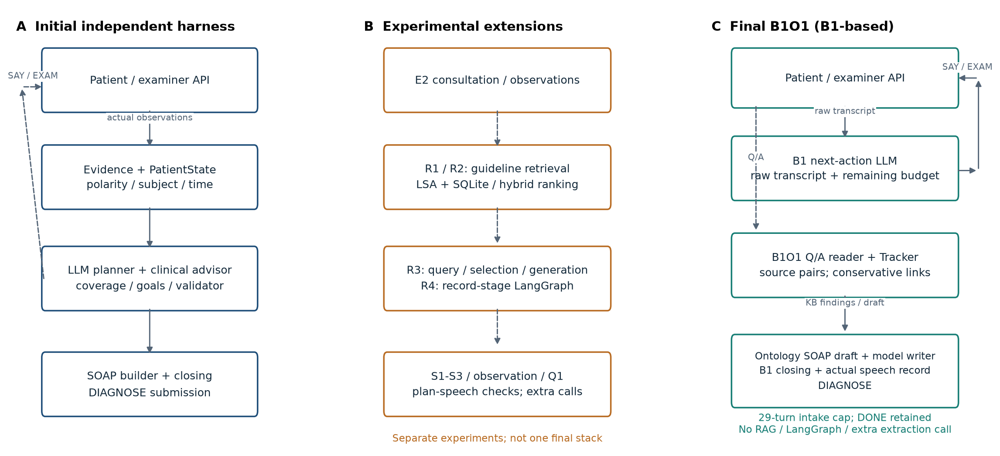
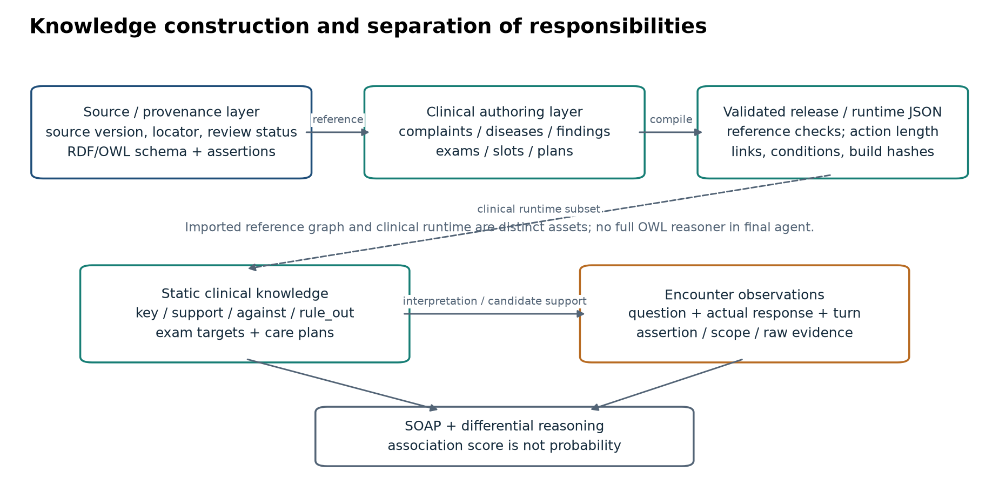
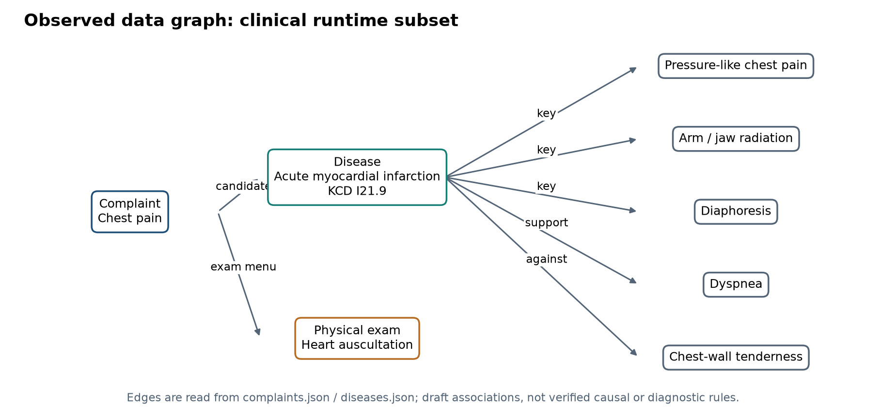
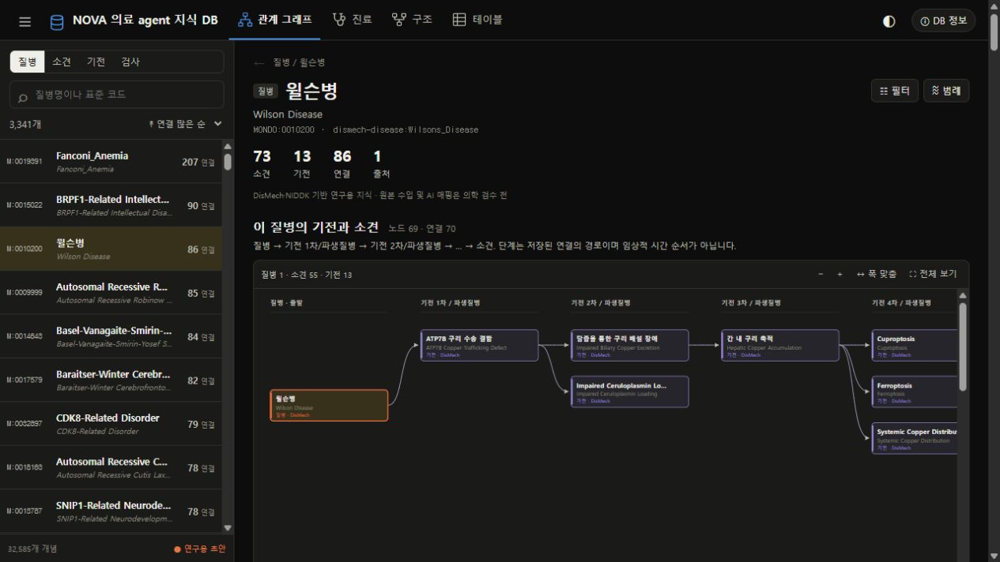
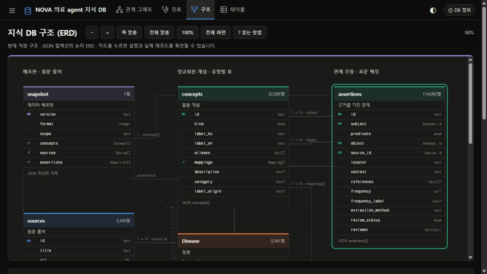
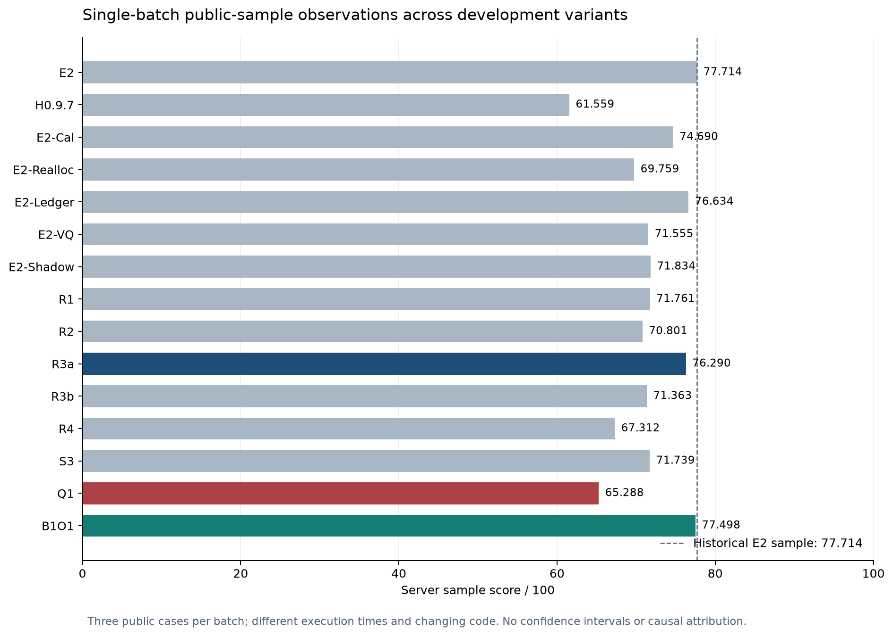
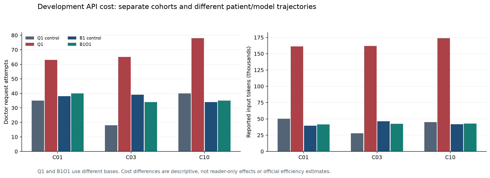

> 2026-10-23 기준 연구 README 보존본. 2026-11-08 고찰 편찬 시 보존했으며 본문의 당시 상태와 수치는 변경하지 않았다.

# 관찰 근거와 의료 온톨로지를 결합한 진료 에이전트의 설계·실험·회귀 분석

*Design, Experiments, and Regression Analysis of an Observation-Grounded Medical Agent*

N.O.V.A. 2026 기술 사례연구 · 기준일 2026-10-23 · 최종 후보 **B1O1**

> 개발 종료 시 작성한 연구 기록이다. 동료 심사를 받은 논문이나 임상 검증 결과가 아니다. 이 문서는 저장소 메인 연구 기록이다. 기존 지식 DB 사용 안내는 [보존 문서](../../docs/README_knowledge_archive.md)에 있다. 기존 안내는 [보존 README](../../nova_harness/docs/README_development_archive.md), 전체 의사결정은 [DECISIONS](../../nova_harness/DECISIONS.md)에 남겼다.

## 초록

제한된 상호작용 예산에서 가상 환자의 실제 응답과 진찰 결과를 수집하고, 의료 지식과 대조하여 진단 및 SOAP를 생성하는 Doctor Agent를 개발하였다. 기존 팀 MedDB와 E2를 비교·재사용 자산으로 삼아 독립 하네스, 근거 원장, 감별 수렴 관찰, 지침 검색, 역할 분리 프롬프트, LangGraph, 안전 의무 검증, 모델 주도 질문 선택을 실험하였다. 주요 실패는 원문 보존과 정보수집 성능 사이의 간극, 계획과 실제 교육의 혼동, 경고 축약·미전달, 문자열 검증의 과도한 거절, 중복 모델 호출에 따른 비용 증가였다.

최종적으로 팀원이 개발하여 main에 병합한 B1을 기반으로, 추가 추출 모델 호출 없이 질문–응답 출처와 보수적 관찰 해석을 연결한 B1O1을 구성하였다. 사용자 제공 서버 샘플 검증은 **77.498/100, 안전15/15**였다. Q1의65.288보다12.210점, R3a의76.290보다1.208점 높지만 초기 E2 샘플77.714보다 **0.216점 낮다**. 실행 시점과 여러 구성요소가 달라 단일 모듈의 인과 효과를 주장하지 않는다. 리더보드 목표78·85·90 달성은 확인하지 못했다. 본 사례는 기능 누적보다 관찰 출처·행동 예산·실제 설명·기록의 일치성을 검증하는 중요성과 한계를 보여준다.

**핵심어:** 의료 에이전트, 온톨로지, SOAP, 근거 추적, RAG, 안전 전달, 회귀 분석

## 1. 문제 정의와 초기 구상

출발점은 기존 에이전트의 점수 정체였다. 사용자는 의료 온톨로지와 프롬프트·하네스를 결합하고, 개발 API 실행 → 로그 분석 → 가설 → 수정 → 비교의 순환으로 개선하기를 요청하였다. 목표는 리더보드78 →85 →90이었다. 환자의 답변을 임의로 생성하는 대신 실제 환자 API의 응답과 진찰 결과를 근거로 감별 후보를 좁히고 SOAP를 작성하는 것이 핵심 원리였다.

연구 질문은 ① 원문과 구조화 관찰의 병행 보존이 정보 소실과 잘못된 정상화를 줄이는가, ② 온톨로지와 검색 근거가 문진·감별·기록을 개선하는가, ③ 안전 계획과 실제 전달 사이의 간극을 줄일 수 있는가, ④ 추가 추론 비용이 이득을 상쇄하는가였다.

Doctor는 `openai/gpt-6-luna`이며 과거 gpt-oss나 잘못 언급된 gpt-gemini와 구분하였다. SAY/EXAM 행동 길이와 최대50턴의 계약 아래 진단·SOAP를 제출한다. 최신 계약은 [공식 개발 가이드](https://nova.snubhai.org/docs/)를 기준으로 하였다.

초기 독립 하네스는 `Gateway → PatientState/Evidence → ClinicalAdvisor/CoveragePlanner → LLM 행동 선택 → 검증 → API → 상태 갱신 → NoteBuilder`의 순환이었다. 의료 지식으로 확인 항목을 만들고 관찰 상태로 완료 항목을 제외하려 했다. 그러나 사실 전체를 매번 생성하면 출력과 절단이 증가했고, 증분 추출로 줄이면 조기 종료와 문진 부족이 남았다. [초기 개발](../../nova_harness/reports/development_001.md), [로그 비교](../../nova_harness/reports/log_comparison_008.md).



**그림1.** 왼쪽은 초기 독립 하네스, 가운데는 별도의 실험 확장, 오른쪽은 최종 B1O1이다. 가운데 모듈을 모두 최종본에 누적한 것이 아니다. 최종 다음 행동 모델의 입력은 원문 대화와 예산이며 reader 상태가 별도 질문 선택기를 직접 구동하지 않는다. [SVG](../../nova_harness/assets/paper/fig01_architecture_evolution.svg).

## 2. 의료 지식 및 온톨로지 구축

### 2.1 출처·저작·런타임의 분리

MedDB의 기존 팀 자산을 재사용·확장하였다. DisMech, DDXPlus, KCD/HIRA 등 참조 자산과 임상 저작 부분집합을 구분하며 모두 이번 개발자가 새로 구축했다고 주장하지 않는다. 출처별 이용 조건과 검수 상태는 [팀 소스 목록](../../docs/SOURCES.md)에 있다. 임상 저작 자료는 검수 전 초안을 포함한다.

참조 스키마는 Concept, Disease, Finding, Test, Assertion, Source, Mapping과 관계·출처·검수 상태를 표현한다. 주호소·질환·소견·진찰·질문 슬롯·계획은 저작 자료에서 런타임 JSON으로 컴파일하며 참조 무결성과 행동 길이를 점검한다. 형식 검사는 임상 타당성 검증을 대신하지 않는다. 최종 에이전트는 전체 참조 그래프를 OWL 추론기로 실행하지 않는다.

| 계층 | 실제 규모 | 해석 |
|---|---:|---|
| 참조 릴리스 `meddb-2026.10.13.1` | 개념32,585 / assertion114,092 / 출처3,345 | 기존 팀 참조 지식 |
| 임상 런타임 | 주호소19 / 질환135 / 소견291 | 에이전트용 부분집합 |
| 행동 자산 | 진찰56 / 슬롯19 | 증례별 선택 자산 |
| 질환–소견 관계 | key384 / support507 / against135 / rule_out51 | 저작 연관이며 진단확률 아님 |

수치는 실제 릴리스·JSON에서 추출하였다. [통계 원본](../../nova_harness/docs/paper/ontology_statistics.json). 초기 비교 시드의134질환·289소견과 최종 집계는 시점이 다르다.



**그림2.** 출처 관리→임상 저작→컴파일의 구성과 정적 지식·환자 관찰의 역할 분리. 지식은 해석을 지원하지만 환자 관찰을 대체하지 않는다. [SVG](../../nova_harness/assets/paper/fig02_ontology_construction.svg).

### 2.2 관찰의 개념화

“입맛이 없어 적게 먹었다”를 식욕부진에 연결하되 질문·응답 원문·턴을 함께 보존하는 원칙을 세웠다. “설사는 없지만 묽은 변은 가끔”, “가족이 앓았다”, “과거에 있었다”는 현재 환자의 단순 양성·음성으로 평탄화할 수 없다. 개념 외에 assertion·주체·시간·질문 범위·정정 관계가 필요하며 모호한 응답은 구조화 판정을 유보해야 한다.



**그림3.** 실제 `complaints.json`·`diseases.json`에서 추출한 흉통–급성 심근경색–소견·진찰의 부분 그래프다. 공개 증례 정답이 아니며 검수 전 저작 연관을 나타낸다. `against`는 확정 배제를 의미하지 않는다. [SVG](../../nova_harness/assets/paper/fig03_runtime_ontology_graph.svg).

### 2.3 기존 MedDB의 온톨로지 탐색 화면

아래 두 그림은 기존 메인 README에 있던 MedDB 화면을 보존한 것이다. 앞의 임상 런타임 부분 그래프와는 별개의 참조 지식·저장 구조를 보여준다. 2026-10-13 로컬 화면이며 이번 B1O1의 새 성능 검증 결과가 아니다.

[](../../docs/readme-graph-full.jpg)

**그림3-A.** 윌슨병의 방향 그래프. 전체 그림은69노드·70연결이며 이미지를 누르면 원본을 볼 수 있다. 기전 단계는 저장된 관계의 배치로, 임상적 시간 순서나 진단 확정 단계가 아니다. 관계를 역으로 따라간다고 질환이 확정되지 않는다.

[](../../docs/readme-schema.jpg)

**그림3-B.** 개념(`concepts`)·관계(`assertions`)·출처(`sources`)·개념 내부 매핑 구조. 의료 자산은 버전별 압축 JSON이며 독립 SQL 의료 테이블을 뜻하지 않는다. 전체 화면·기능 안내는 [기존 지식 DB README](../../docs/README_knowledge_archive.md)에 보존하였다.

## 3. 평가 방법과 해석 원칙

| 측정 | 용도 | 한계 |
|---|---|---|
| 서버 샘플 검증 | 공개 C01·C03·C10 제출 결과 | 제출별 한 집계, 리더보드 아님 |
| 리더보드 | 별도 증례의 공식 점수 | 샘플과 직접 혼합하지 않음 |
| 개발 API·별도 모델 검토 | 대화·오류·비용·누락 분석 | 검토자 추정 점수는 공식 점수 아님 |
| 단위·합성·저장 재생 | 분기·계약·출처·재현 검사 | 임상 안전·성능 향상의 대리 지표로 충분하지 않음 |

평가는 정보25·진단15·검사/추적10·안전15·소통15·효율20점이다. 개발 API와 평가 환경은 [평가 안내](https://nova.snubhai.org/evaluation/) 및 [개발 문서](https://nova.snubhai.org/docs/)에 따라 구분한다. 상세 루브릭 전체는 관찰하지 못했다.

샘플 표의 각 행은 공개3증례에 대한 한 제출 집계다. 실행 시점·환자 경로·모델 출력·코드가 달랐고 반복 무작위 대조·신뢰구간·통계적 유의성을 확보하지 못했다. 영역 점수는 반올림되므로 총점은 서버 표시값을 유지한다. 캡처에 파일명·해시가 없는 결과는 대화 맥락으로 연결했으며 독립적 해시 일치를 주장하지 않는다.

## 4. 개발 경과: 문제·개입·관찰·결정

| 단계 | 문제·가설 | 구현과 실험 | 결과·결정 |
|---|---|---|---|
| 독립 하네스 | 상태·지식 지원으로 점수 정체 해소 | 증분 사실 추출, coverage/goals, 검증, SOAP | 출력 절단·조기 종료·비용 증가 |
| v0.4–0.9 | 누락과 종료 설명 관리 | 증상/결정 축, 우선순위, 반복 방지, 마무리 예산 | 개발 점수 개선이 서버 개선으로 이어지지 않음 |
| H0.9.7 | 독립 구조 제출 | 서버 샘플 검증 | 61.559, E2보다 지연·효율 악화 |
| E2 재기반 | 기존 문진 흐름 보존 | calibrated, 약물 검토, 턴 재배정, 응답 복구 | 74.690·69.759, 단일 개발 고득점 일반화 실패 |
| Evidence Ledger | 응답의 SOAP 소실 방지 | 성공 SAY/EXAM 출처 원장·라우팅 감사 | 122관찰 추적, 샘플76.634. 보존만으로 불충분 |
| 개념화·질문 가치 | 중복·누락 축소 | 압축 후보와 질문 변경을 별도로 구현 | 제출 질문 후보71.555. 압축은 별개여서 압축 탓으로 단정 불가 |
| 감별 수렴 shadow | 후보 축소 과정 관찰 | 순위·share·간격·안정성·미배제 위험 | 행동 유지,71.834. share는 확률 아님; 능동 조기 종료 미채택 |
| R1/R2 | 지침 근거로 기록 개선 | 청킹·LSA·SQLite 및 혼합 순위 | 71.761→70.801, 검색만으로 개선 안 됨 |
| R3a | 환자와 안 맞는 근거 배제 | 검색 후보 부분집합 선별·실패 복귀 | 76.290·안전15, RAG 복구점 동결 |
| R3b/R3c/R4 | 질의·선별·생성 분리 | 질의·생성 역할, 기록 단계 LangGraph | 71.363·67.312, 안전10·7.5. 도구 자체 인과로 단정 불가 |
| S1/S2/S3 | 계획·발화·SOAP 불일치 | 의무 원장·실제 전달·복구·그룹 배정 | S3 71.739·소통8.17·안전10, 임상 완전성 미확보 |
| 상태·엣지케이스 | 가족·과거·부분 부정·정정 오해 | 응답 상태·질문 연결·coverage 순서·12합성 사례 | 예상 취약7·기존 보호5, 임상 오류율 아님 |
| 관찰 단일 해석 | 질문 완료와 현재 소견 혼동 | 단일 출처 해석·question contract·상태 투영 | 303테스트·최종3세션, 추가 호출·부분응답 한계 |
| 계획 inventory | 계획을 빠짐없이 전달 | 항목 추출→렌더링→실제 수행 기록 | 318테스트에도 전달0/11·0/7·9/11, C10 50턴. 미채택 |
| Q1 | 필수 첫 질문 대신 모델 선택 | 메뉴·자유 질문·재시도·fallback | 입력 중복 예산 오류 수정 후도 고비용.65.288 미채택 |
| B1O1 | B1 비용·종료 구조 보존 | 병합 main 기반 별도 reader·Q/A 출처 연결 | 77.498·안전15, 동결 후 개발 종료 |

각 단계의 구현·폐기·미해결 근거는 [전수 보고서 목록](../../nova_harness/docs/paper/experiment_inventory.md)과 [DECISIONS](../../nova_harness/DECISIONS.md)에 있다. 표는 모든 모듈을 최종본에 결합했다는 뜻이 아니다.

### 4.1 초기 개발 평가 변동

다음은 개발 대화를 별도 검토 모델로 평가한 **비공식 추정치**다.

| 버전 | C01 | C03 | C10 |
|---|---:|---:|---:|
| v0.7.3 기준 | 61 | 69 | 78 |
| v0.8.0 | 70 | 68 | 74 |
| v0.8.0.1 | 68 | 71 | 79 |
| v0.8.1 | 66 | 71 | 76 |
| v0.8.2 | 66 | 72 | 73 |
| v0.8.3 | 66 | 66 | 75 |

18개 실제 진료는 [9차 보고](../../nova_harness/reports/development_009.md)에 있다. 동일 대화 재검토도72/70 등 변동하여 개발 추정치만으로 제출 권고를 확정할 수 없었다.

### 4.2 RAG 네 단계의 구현 범위

| 계획 | 실제 구현 | 미구현·제외 |
|---|---|---|
| 청킹·임베딩·벡터 저장 | 지침4,488·청크158,727, TF-IDF→SVD 64차원 LSA, int8벡터 SQLite | 사전학습 신경망·원격 벡터 DB 아님 |
| 유사도 검색 개선 | R1 정규화 코사인에 R2 BM25·코사인 RRF·coverage 재정렬 | MMR·ANN 미구현 |
| 세 프롬프트 역할 | R3a 적합성 선별, R3b 질의 계획, R3c 기록 생성 | R3c 단독 서버 결과 없음 |
| LangGraph | 기록 단계 검색·선별·생성 조율·재생 검사 | 문진 정책·능동 수렴·조기 종료를 대체하지 않음 |

지침 원문은 경로·해시·행 위치로 확인하였고 공개 정답·모범 기록을 런타임에 넣지 않았다. LSA를 신경망 임베딩으로 표현하지 않는다. 최종 B1O1에는 RAG/LangGraph를 결합하지 않았다. [R1](../../nova_harness/reports/development_033.md), [R2](../../nova_harness/reports/development_034.md), [R3a](../../nova_harness/reports/development_036.md), [R3b](../../nova_harness/reports/development_038.md), [통합](../../nova_harness/reports/development_039.md).

## 5. 서버 샘플 검증 결과

| 버전 | 총점 /100 | 정보 /25 | 진단 /15 | 검사·추적 /10 | 안전 /15 | 소통 /15 | 효율 /20 |
|---|---:|---:|---:|---:|---:|---:|---:|
| E2 | 77.714 | 11.94 | 15.00 | 8.64 | 15.00 | 7.72 | 19.42 |
| H0.9.7 | 61.559 | 11.00 | 15.00 | 5.67 | 15.00 | 4.89 | 10.00 |
| E2-Cal | 74.690 | 12.33 | 15.00 | 8.17 | 12.50 | 7.11 | 19.58 |
| E2-Realloc | 69.759 | 12.26 | 15.00 | 6.86 | 10.00 | 6.22 | 19.42 |
| E2-Ledger | 76.634 | 11.52 | 15.00 | 8.86 | 15.00 | 6.83 | 19.42 |
| E2-VQ | 71.555 | 12.04 | 15.00 | 8.39 | 10.00 | 6.50 | 19.63 |
| E2-Shadow | 71.834 | 12.00 | 15.00 | 8.44 | 10.00 | 6.83 | 19.55 |
| R1 | 71.761 | 11.48 | 15.00 | 8.89 | 10.00 | 6.39 | 20.00 |
| R2 | 70.801 | 10.38 | 15.00 | 8.67 | 10.00 | 7.44 | 19.31 |
| R3a | 76.290 | 12.04 | 15.00 | 8.64 | 15.00 | 6.72 | 18.89 |
| R3b | 71.363 | 10.75 | 15.00 | 8.64 | 10.00 | 7.56 | 19.42 |
| R4 | 67.312 | 11.13 | 15.00 | 8.00 | 7.50 | 6.39 | 19.29 |
| S3 | 71.739 | 11.14 | 15.00 | 8.89 | 10.00 | 8.17 | 18.54 |
| Q1 | 65.288 | 10.04 | 12.78 | 7.97 | 13.75 | 7.72 | 13.02 |
| B1O1 | 77.498 | 12.37 | 14.44 | 8.61 | 15.00 | 8.06 | 19.02 |

각 행은 공개3증례의 한 제출 집계다. [원자료·개별 출처](../../nova_harness/docs/paper/sample_scores.json). E2-VQ는 질문 후보, E2-Shadow는 행동 불변 관찰 후보, S3는 안전 전달 후보다.



**그림4.** 시간에 따른 인과 추세를 가정하지 않는 관찰값이다. 점선은 초기 E2 샘플. [SVG](../../nova_harness/assets/paper/fig04_sample_results.svg).

| 자산 | 리더보드 | 범위 |
|---|---:|---|
| 기존 E2 | 67.132 | 사용자 제공5증례 결과, 샘플과 구분 |
| 팀원 B1 / PR6 | 70.02 | 팀원 보고 결과, [검토](../../nova_harness/reports/review_pr006_053.md) |
| 최종 B1O1 | 미확인 | 최종 제공값은 샘플77.498 |

| 최종 B1O1 비교 | 총점 차이 | 해석 |
|---|---:|---|
| Q1 대비 | +12.210 | 베이스·비용 구조까지 변경됨 |
| R3a 대비 | +1.208 | 서로 다른 계열·시점 |
| E2 샘플 대비 | −0.216 | 전체 최고 성능 갱신 아님 |
| 샘플78 대비 | −0.502 | 리더보드 목표와 별개 |

최종 C01/C10/C03은41/41/40턴,266/292/258초였다. 정보12.37/25·소통8.06/15에 결손이 남는다. 집계만으로 원문 소실·반복·경고 누락의 기여를 확정할 수 없다. [최종 결과](../../nova_harness/reports/analysis_059.md).

## 6. 구조적 실패 분석

### 6.1 원문 보존·해석 정확성·좋은 행동은 별개다

원장이 완전해도 이미 확보한 내용을 반복하거나 진단을 구분하지 못하는 질문을 하면 정보수집은 개선되지 않는다. 압축 개념이 주체·시간·부정 범위를 잃으면 근거도 왜곡된다. 원문 보존, 구조화 의미 일치, 질문의 정보 가치, SOAP 반영을 각각 평가해야 한다. 이번 개발에서 이 네 가지 모두를 임상적으로 검증하지는 못했다.

### 6.2 계획과 실제 수행을 구분해야 한다

계획을 생성한 것과 실제 SAY 성공으로 전달한 것은 다르다. SOAP가 계획을 교육 완료로 적거나 짧은 경고에서 조건·행동·시점이 소실되는 문제가 관찰됐다. S1–S3와 inventory는 이를 추적했지만 강한 문자열 검증이 적절한 자연어도 거절하였다. 최종 inventory는 C01/C03 전체 거절, C10 반복 경고로50턴을 소비했다. 행동 타입·조건·시점 분리와 그룹 렌더러는 **미구현 후속 설계**다. [41차](../../nova_harness/reports/development_041.md), [44차](../../nova_harness/reports/development_044.md), [52차](../../nova_harness/reports/development_052.md).

### 6.3 비용은 구조 설계의 일부다

Q1은 별도 해석·선택 호출과 문맥 중복으로 최초 예산 오류가 발생했다. 중복 입력을 제거해도 비용은 높았다. 아래는 개발 API 요청 시도와 보고된 입력 토큰이며 공식 효율 계산식이 아니다.

| 조건 | C01 요청 / 입력 | C03 요청 / 입력 | C10 요청 / 입력 |
|---|---:|---:|---:|
| Q1 기준 | 35 / 50,320 | 18 / 27,714 | 40 / 44,987 |
| Q1 최종 | 63 / 161,322 | 65 / 161,962 | 78 / 173,876 |
| B1 기준 | 38 / 39,390 | 39 / 46,193 | 34 / 41,859 |
| B1O1 | 40 / 41,518 | 34 / 42,520 | 35 / 42,887 |



**그림5.** 서로 다른 기반·환자 경로의 기술 통계이며 reader 단독 효과가 아니다. [SVG](../../nova_harness/assets/paper/fig05_development_cost.svg), [Q1 검증](../../nova_harness/reports/development_054.md), [B1 검증](../../nova_harness/reports/development_057.md).

### 6.4 테스트 통과는 임상 성능의 증명이 아니다

관찰 해석의 합성 검증은 문맥 없는 입력7/10, 명시 문맥10/10이었다. 입력이 달라 코드만의 개선으로 볼 수 없다. inventory는318테스트 뒤에도 실제 전달이 실패했다. Q1의331테스트·재생 일치도 샘플 회귀를 예측하지 못했다. 재생은 기록된 입력에서 동일 행동을 재현하는 검사이지 더 좋은 행동이라는 증명이 아니다.

## 7. 최종 B1O1 및 종료 결정

팀원 PR6가 병합된 main `05f9ed0`을 일반 병합하였다. B1에는 선택적 reader 연결만 추가하고 `agent_b1_observed.py`·`reader_b1_observed.py`로 후보를 분리했다. 기본 B1을 자동 교체하지 않았다.

1. B1 다음 행동 모델이 실제 원문 대화와 예산으로 질문·진찰·DONE을 선택한다.
2. reader가 실제 질문–응답과 턴을 보존한다. 표준 단일 질문의 짧은 긍정·부정을 보수적으로 연결하고 가족·과거·부분·모호함은 무리하게 현재 이진 소견으로 바꾸지 않는다.
3. Tracker와 지식으로 SOAP 초안을 보조하며 최종 기록 모델에 원문 대화를 제공한다. 질문 완료와 현재 소견은 구분한다.
4. B1의29턴 문진 상한·DONE·마무리를 유지한다. 29는 전체 상호작용 총수가 아니므로 최종40–41턴과 모순되지 않는다.

Q1 선택기·추가 모델 추출·RAG·LangGraph는 최종본에 없다. reader는 보수적 규칙 기반이며 완전한 의료 언어 이해 엔진이 아니다. 실제 세 세션에서 짧은 예/아니요 `single_question_link` 분기는0회여서 해당 기능 효과는 합성 검증에 한정된다.

저장소 루트143테스트(4skip), 기존 하네스331테스트, B1·후보 각3개 API 세션 및6개 엄격 재생을 확인하였다. 진찰 거절·제공자 오류는 남았다. 압축 해제본3증례 입력·행동·SOAP 일치를 확인했지만 Docker·공식 실행 환경의 별도 검증은 아니다.

| 동결 항목 | 값 |
|---|---|
| 제출 파일 | `submission_B1O1_observation.zip` |
| 런타임 커밋 | `734d0d6` |
| 크기 / 파일 수 | 16,017,348바이트 /54 |
| SHA-256 | `cb5155eeb5cb46de49417b5b983c7dc6b7a3a60b95696132e2ecf87d1f0a10db` |
| 검증 근거 | [58차](../../nova_harness/reports/submission_058.md), [매니페스트](../../nova_harness/reports/submission_b1o1_manifest_058.json) |
| 종료 상태 | 사용자 요청으로 개발 종료, 자동 병합·공식 업로드 없음 |

패키지는 [참가 규칙](https://nova.snubhai.org/rules/)의 제약을 기준으로 관리했다. 키·로그·개발 문서·ZIP 자체는 Git 공개 대상에서 제외했다.

## 8. 최종 강평과 한계

**성과:** 관찰·지식·행동·실제 전달·SOAP를 구분하는 실험 체계를 만들고 실패와 비용도 남겼다. 마지막에는 팀원의 B1에 관찰 연결을 제한적으로 추가하여 샘플77.498·안전15를 확보하였다. 실패한 후보를 최종 기능으로 숨기지 않고 동결 자산·재생 근거를 보존하였다.

**성능 평가:** 초기 E2 샘플77.714를 넘지 못했으므로 전체 개발이 최고 성능을 갱신했다는 결론은 성립하지 않는다. Q1에서 회복했지만 reader 단독 효과는 분리하지 못했다. R3a·B1O1의 안전15도 임상 안전성의 증명은 아니다. 리더보드 목표78·85·90은 달성 확인 없이 종료하였다.

**핵심 교훈:** 지식을 늘리는 것, 원문을 저장하는 것, 좋은 질문을 고르는 것, 설명을 실제 전달하는 것은 다른 과제다. 경계를 흐린 채 기능을 누적하면 비용과 검증 충돌만 늘 수 있었다. 계획을 수행으로 기록하는 오류는 문서의 겉보기 완성도보다 중요했다. 문자열 검사는 의미 검증의 대체물이 아니었다.

**한계:** 공개3증례 반복에 따른 과적합 가능성, 버전별 비동시 실행, 모델·환자 경로 변동, 상세 채점 비공개, 반복 대조 부족, 검수 전 지식, 실제 환자 및 외부 임상 검증 부재가 있다. 통계적 유의성·일반화·임상 안전을 주장하지 않는다. 모든 SOAP의 임상 충실도를 전수 판정하지도 못했다.

후속 연구는 동시점 B1 반복 대조, 질문별 정보 증가의 독립 평가, 출처 연결 문장 단위 SOAP 감사, 행동·조건·시점을 보존하는 설명 렌더링을 우선할 수 있다. 이는 **개발 종료 시 미구현 과제**이며 최종 기능이 아니다.

## 9. 기여 구분과 재현 자료

- **기존 팀:** MedDB 참조·임상 지식, E2·B1, 팀원 PR6 구현 및 보고된 리더보드 결과.
- **이번 개발:** 독립 하네스와 실험 분기, RAG 단계, 관찰·안전 전달 검증, Q1 회귀 분석, B1O1 reader, 패키징·재생·의사결정 기록.
- **개발 방식:** 사용자 요구·승인과 AI 코딩 지원을 통한 구현·검토. 저자·소속·IRB·독립 임상 검수자 정보를 임의로 작성하지 않았다.
- **공개 범위:** 집계·구현·테스트·출처·그림. 키·개인 원문 실행 로그·제출 ZIP은 제외한다.

[그림 생성기](../../nova_harness/tools/build_paper_figures.py), [의존성](../../nova_harness/tools/requirements-paper.txt), [표 데이터](../../nova_harness/docs/paper/sample_scores.json), [그림 매니페스트](../../nova_harness/assets/paper/figure_manifest.json)로 재생성할 수 있다. MedDB 데이터가 있는 저장소 배치가 필요하며 아래 과정은 API를 호출하지 않는다.

```bash
python3 -m pip install -r nova_harness/tools/requirements-paper.txt
python3 nova_harness/tools/build_paper_figures.py
```

실행 안내는 [보존 README](../../nova_harness/docs/README_development_archive.md), 저장소 경계는 [인계 문서](../../nova_harness/docs/REPOSITORY_HANDOFF.md), 모든 과거 보고서는 [전수 목록](../../nova_harness/docs/paper/experiment_inventory.md)에 있다.

## 참고 자료

1. N.O.V.A. 2026. [개발 가이드](https://nova.snubhai.org/docs/), [참가 규칙](https://nova.snubhai.org/rules/), [평가](https://nova.snubhai.org/evaluation/). 확인 기준2026-10-23.
2. [MedDB 저장소](https://github.com/SSAFY16-S11-NOVA2026/MedDB), [개발 PR5](https://github.com/SSAFY16-S11-NOVA2026/MedDB/pull/5), [팀원 PR6](https://github.com/SSAFY16-S11-NOVA2026/MedDB/pull/6).
3. [대회 자료](../../nova_harness/nova_reference/README.md), [기존 자산 검토](../../nova_harness/reports/meddb_review_003.md), [실험 전수 목록](../../nova_harness/docs/paper/experiment_inventory.md), [의사결정](../../nova_harness/DECISIONS.md).
