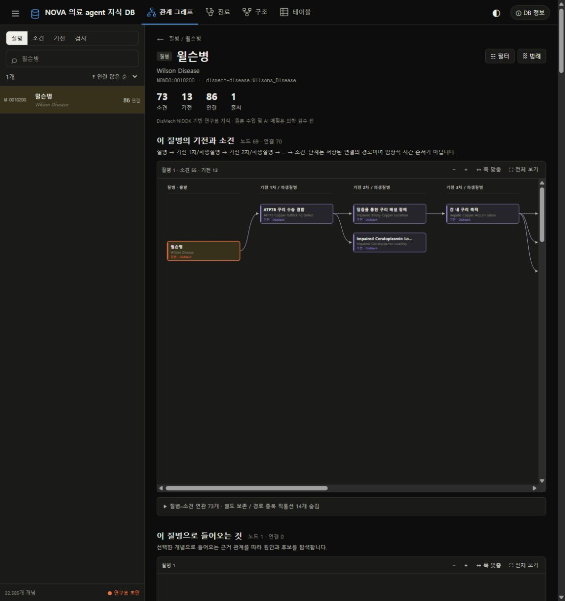

# 사이트 접속 복구 — 2026-10-13

원인: 기본 포트 8765에 서버가 실행되고 있지 않았고, 이전 임시 실행은 지속되지 않았다. 샌드박스에서 시작한 서버의 로컬 접속도 제한되었다.

`Start-MedDB.ps1`은 저장소 폴더에서 Python을 찾아 서버를 숨김 창으로 실행하고 `/api/health`에서 실제 준비 완료를 확인한다. 실행 중인 MedDB는 재사용하며, 다른 프로그램이 기본 포트를 사용하면 8766~8775에서 빈 포트를 선택한다. 주소·PID·로그 위치는 `.run/server.json`에 기록한다. 시스템 재시작 뒤에는 다시 실행해야 한다.

```powershell
./Start-MedDB.ps1
```

서버는 실제 포트 바인딩 뒤 준비 메시지를 출력한다. 건강 확인 API와 웹 자산의 no-store 응답, 초기 데이터 로딩 안내를 추가했다.

브라우저에서 최신 판의 질환 목록·윌슨병 그래프를 확인했다. 가상 테스트 입력 `열이 없어요 / 구토가 있어요`를 해석·확인·적용한 뒤 파일럿 후보 7개와 다음 확인 제안이 표시되는 것을 확인했다. 의학적 정확도 검증이 아닌 UI/API 연결 검사다.

Python 테스트 총 56개 중 52개 통과, RDF/SHACL 의존성 미설치로 4개 skip. JavaScript 문법 검사 통과. 원본 PPT 내부 파일의 Git 커밋 바이트도 manifest 해시와 대조했다.


